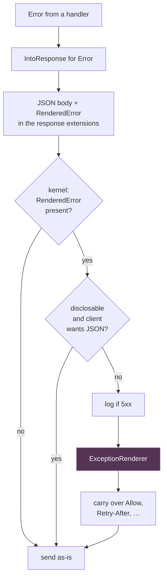

# Error Handling

Rainier has one error type. A handler returns `Result<T>`, uses `?` freely, and
the framework turns whatever comes out into the right status code.

Where an exception-based framework grows a hierarchy — an authentication
failure that renders as 401, a validation failure that renders as 422 —
Rainier has an enum, because Rust has no exception hierarchy to hang one on.

```rust
use rainier_framework::prelude::*;

pub async fn show(request: Req) -> Result<Response> {
    let slug = route_param(&request, "post")?;              // 400 if absent
    let post = posts.find_or_fail(slug).await?;             // 404 if no row
    PostPolicy::gate().authorize("posts.view", &user, Some(&post))?;   // 403
    Ok(Response::json(&post))
}
```

## `ErrorKind`

| Kind | Status | Raised by |
|---|---|---|
| `BadRequest` | 400 | malformed input, a missing route parameter |
| `Unauthenticated` | 401 | guards |
| `Unauthorized` | 403 | gates and policies, a failed `authorize()` |
| `NotFound` | 404 | no route, `find_or_fail` |
| `MethodNotAllowed` | 405 | the router |
| `Conflict` | 409 | you |
| `PayloadTooLarge` | 413 | the body limit |
| `Validation` | 422 | the validator |
| `TooManyRequests` | 429 | the throttle middleware |
| `Internal` | 500 | anything unhandled |
| `ServiceUnavailable` | 503 | maintenance, a dead dependency |
| `Status(u16)` | yours | anything else — `408` is spelled this way |

`service_unavailable` is the one people reach for least and should reach for
most: a health check that cannot see the database should answer `503`, not
`500`. A `500` says "this service is broken"; a `503` says "try again", which
is what a load balancer and a retrying client both need to hear.

## Constructing

```rust
Error::bad_request("The `since` parameter must be a date.")
Error::unauthenticated("Unauthenticated.")
Error::unauthorized("This action is unauthorized.")
Error::not_found("No Post matches the given key.")
Error::conflict("That slug is already taken.")
Error::request_timeout("The request did not finish within 30 seconds.")
Error::too_many_requests("Slow down.")
Error::service_unavailable("The search index is unreachable.")
Error::internal("could not reach the search index")
Error::validation(errors.to_json())

Error::new(ErrorKind::Status(418), "I'm a teapot")
```

And to enrich:

```rust
Error::internal("upload failed")
    .with_source(io_error)                    // the underlying cause
    .with_details(json!({ "field": "avatar" }))
    .with_kind(ErrorKind::BadRequest)
```

Read it back with `.kind()`, `.status()`, `.message()`, `.details()`,
`.source_error()`.

## Converting

`?` works on anything with a `From` impl. These ship:

| From | Becomes |
|---|---|
| `anyhow::Error` | `Internal` |
| `std::io::Error` | `Internal` (or `NotFound` for a missing file) |
| `serde_json::Error` | `Internal` |
| `ValidationErrors` | `Validation` |

For your own error types, implement `From<MyError> for Error` once and every
`?` in every handler starts working.

### Adding context

```rust
use rainier_framework::prelude::*;   // brings `Context`

let config = std::fs::read_to_string(path)
    .context("reading the search index configuration")?;

let user = maybe_user.context("the session referenced a user that no longer exists")?;
```

`Context` works on both `Result` and `Option`, like `anyhow`'s.

## What the client is told

This is the rule worth internalising:

> **A `4xx` message is always shown. A `5xx` message never is, unless debug
> mode is on.**

A `4xx` describes what the *client* did — "the title field is required", "no
Post matches the given key" — and is useless if hidden.

A `5xx` describes what *your server* did, and those messages routinely contain
a connection string, a file path, or a query. Outside debug the client gets
`"Server Error"` and the real message goes to the log:

```rust
tracing::error!(status = error.status, error = %error.message, "server error");
```

The mechanism is a `disclosable` flag on `RenderedError`, set from
`!kind.is_server_error()`. Debug mode (`APP_DEBUG=true`, which sets `app.debug`,
which the kernel reads) overrides it.



`RenderedError` lives in the response's **extensions**, so it never reaches the
client. It is what lets the kernel tell a JSON error body it produced from one a
handler deliberately returned — and therefore lets it offer a browser an HTML
page instead.

## The exception renderer

`DefaultExceptionRenderer` negotiates on content type:

- the client [expects JSON](requests.md#headers) → a JSON object with `message`
  and, if present, `errors`
- otherwise → a minimal HTML error page, with the message escaped

Replace it to render your own error pages:

```rust
pub struct MyRenderer;

impl ExceptionRenderer for MyRenderer {
    fn render(&self, request: &Request, error: &RenderedError, debug: bool) -> Response {
        if request.expects_json() {
            return Response::json(&json!({ "error": error.message })).with_status(…);
        }
        let html = View::instance()
            .render(&format!("errors.{}", error.status), &json!({ "message": error.message }))
            .unwrap_or_else(|_| fallback_page(error));
        Response::html(html).with_status(…)
    }
}
```

```rust
let kernel = Kernel::from_shared(router, global).with_renderer(Arc::new(MyRenderer));
```

It is a port because the right answer differs per application: an API returns
JSON, a monolith returns a styled page, and both want to decide for themselves
what a 500 discloses.

## Panics

A panic anywhere in a handler is caught and becomes a `500`. The detail is
logged; the client sees it only in debug mode. See
[the lifecycle](lifecycle.md#panics-do-not-take-down-the-process) for why the
catching is per-poll rather than around the closure.

Panics are a backstop, not a control-flow mechanism. Return `Err`.

A caught panic is always [reported](#reporting), as an `HttpRequestFailed`
with `exception.panic` set — `dont_report` never filters one out.

## Debug mode

```env
APP_DEBUG=true
```

Turns on: 5xx messages to the client, and panic details in the response.

**Never in production.** The messages this reveals are exactly the ones an
attacker would like to read. The default is `false`, and the sample project's
`.env.example` says so.

## Errors outside HTTP

The same `Error` is used by [jobs](queues.md), [mailables](mail.md),
[migrations](migrations.md) and [console commands](console.md) — there is one
error type in the framework, not one per subsystem.

A job returning `Err` is released for another attempt. A command returning
`Err` prints the message and exits non-zero. A provider returning `Err` aborts
the boot. In none of those cases is there a client, so the disclosure rule does
not apply and the full message is shown.

In every one of those cases except the boot, the failure is also
[reported](#reporting).

## Reporting

Rendering and reporting are two different jobs. The [exception
renderer](#the-exception-renderer) decides what the **client** sees. Reporting
is how the **application** hears that something failed.

The framework does not decide which failures matter. It **publishes every
failure it would otherwise swallow** — a request that ended in an error, a job
attempt that failed, a command that panicked, a cache write that was lost, a
captcha provider that did not answer, configuration it replaced with a default
— as a typed event on the application's [event bus](events.md). The
**application subscribes** to the ones it cares about and decides what to do:
page someone, send them to an error tracker, count them, ignore them.

### The catalogue

Each kind of failure has its own event struct in `rainier_events::report`
(re-exported as `rainier_framework::report`), with fixed, typed fields. Every
one of them also carries:

- **`exception`** — an `Exception`, a `Clone` snapshot every listener can
  share: `kind` (`None` for a panic), `status`, the error's **own** `message`
  (never the generic one the client got), `details`, the cause chain as
  `sources`, the `backtrace` when there is one, `panic`, and the original
  `Arc<Error>` in `error` for a listener that wants to downcast its source.
- **`meta`** — a [`ReportMeta`](#reportmeta): an id, when, which process, and
  whatever the application attached.

| `FailureKind` | Event | Fields | Emitted by |
|---|---|---|---|
| `HttpRequest` | `HttpRequestFailed` | `method`, `path` (no query string), `route: Option` | the HTTP kernel — every error response and every caught panic (`rainier-server` `kernel.rs`, `server.rs`) |
| `WebSocket` | `WebSocketFailed` | `socket`, `path`, `stage` | the WebSocket upgrade — a failed upgrade or a failing `connect` / `message` / `close` callback (`rainier-server` `upgrade.rs`) |
| `Server` | `ServerFailed` | `operation` | the server outside any request — `accept`, serving a connection (`rainier-server` `server.rs`) |
| `Middleware` | `MiddlewareFailed` | `middleware`, `operation` | middleware that worked around a failure — the throttle's store, a timeout (`rainier-middleware` `builtin.rs`, `timeout.rs`) |
| `Auth` | `AuthFailed` | `guard`, `operation` | guards and password confirmation unable to decide (`rainier-auth` `middleware.rs`, `confirm.rs`) |
| `Session` | `SessionFailed` | `operation` | session load/save and CSRF sealing (`rainier-session` `middleware.rs`, `csrf.rs`, `database.rs`); storing a session delivery key (`rainier-framework` `session_delivery.rs`) |
| `OAuth` | `OAuthFailed` | `operation` | the OAuth server — a `server_error` answer, a failed revocation (`rainier-oauth-server` `error.rs`, `server.rs`) |
| `Account` | `AccountFailed` | `flow`, `operation` | an accounts flow that failed partway — a verification or reset link not sent (`rainier-accounts` `accounts.rs`) |
| `JobAttempt` | `JobAttemptFailed` | `job`, `id`, `queue`, `connection: Option`, `attempt`, `final_attempt` | the queue worker — every failed attempt, released or failed for good, error, panic or timeout (`rainier-queue` `worker.rs`) |
| `QueueMessageDiscarded` | `QueueMessageDiscarded` | `connection`, `queue`, `message_id: Option` | a queue driver throwing away a message it could not read (`rainier-queue` `redis.rs`, `sqs.rs`, `kafka.rs`) |
| `QueueOperation` | `QueueOperationFailed` | `connection: Option`, `queue: Option`, `operation`, `job_id: Option` | ack / release / fail / dead-letter / cleanup failing outside a job's own run (`rainier-queue` `worker.rs`, `redis.rs`, `sqs.rs`, `kafka.rs`) |
| `Command` | `CommandFailed` | `command` | the console — a command's `Err`, or its panic, which is then resumed (`rainier-console` `console.rs`) |
| `ScheduledTask` | `ScheduledTaskFailed` | `task` | `schedule:run` / `schedule:work` — a task that failed (`rainier-framework` `scheduling.rs`) |
| `Listener` | `ListenerFailed` | `event` | the dispatcher — a listener that failed under `dispatch_quietly` (`rainier-events` `dispatcher.rs`) |
| `BackgroundTask` | `BackgroundTaskFailed` | `task` | spawned work — a health check that panicked (`health:<name>`), `queue:work`'s stop-signal handler (`rainier-framework` `health.rs`, `commands.rs`) |
| `Broadcast` | `BroadcastFailed` | `channel: Option`, `operation` | broadcasting — a refused subscription, a broadcaster that fell back to the log, the Kafka relay falling over (`rainier-broadcast` `auth.rs`, `broadcasters.rs`, `kafka.rs`, `pusher_server.rs`; `rainier-framework` `relay.rs`) |
| `Notification` | `NotificationFailed` | `channel`, `notification` | the notifier — a channel that could not deliver (`rainier-notify` `notifier.rs`) |
| `Mail` | `MailFailed` | `mailer`, `operation` | reserved for mail transports; nothing emits it yet |
| `Publish` | `PublishFailed` | `topic`, `event` | `kafka::publish_events` — an event that could not be serialised or produced (`rainier-framework` `kafka.rs`) |
| `Webhook` | `WebhookFailed` | `provider`, `event_id: Option`, `operation` | incoming webhooks (`rainier-billing` `webhook.rs`) |
| `Cache` | `CacheFailed` | `store`, `key: Option`, `operation` | the cache and the rate limiter working around a store failure (`rainier-cache` `cache.rs`, `rate_limit.rs`); the model cache, store `model_cache`, `meta.extra["table"]` (`rainier-framework` `model_cache.rs`) |
| `Database` | `DatabaseFailed` | `connection: Option`, `operation` | the database layer working around a failure (`rainier-database` `connection.rs`) |
| `Filesystem` | `FilesystemFailed` | `disk`, `operation` | a filesystem operation worked around — a temporary file not cleaned up, a write retried (`rainier-filesystem` `local.rs`) |
| `Integration` | `IntegrationFailed` | `service`, `operation` | calls to outside services — captcha verification, service `captcha:<provider>`, `meta.extra["fail_open"]` (`rainier-framework` `captcha.rs`) |
| `Telemetry` | `TelemetryFailed` | `operation` | exporters and the worker's metrics endpoint (`rainier-telemetry` `otlp.rs`; `rainier-framework` `instrumentation.rs`, `commands.rs`) |
| `Configuration` | `ConfigurationFailed` | `setting` | configuration ignored or replaced with a default — a generated `APP_KEY`, CORS no preflight can reach, a per-process rate limiter or scheduler lock, a symlink out of `public/`, a bare `--option` (`rainier-framework` `bootstrap.rs`, `cors.rs`, `limits.rs`, `scheduling.rs`, `public.rs`; `rainier-console` `arguments.rs`; `rainier-container`, `rainier-debug`, `rainier-middleware` `proxy.rs`, `rainier-openapi`, `rainier-queue` `manager.rs`, `redis.rs`) |
| `Application` | `ApplicationFailed` | — | your code — `rainier_framework::report`, `Reporter::report_error`, `report::report_error` |

`Failure` is the same catalogue as an enum, one variant per struct, and
`FailureKind` is the same list without data — for matching, metric labels and
filtering.

### Subscribing

Every report is dispatched **twice**: once as its own typed event, and once
wrapped in the catch-all `ExceptionReported { failure }`. Listen for the typed
event to handle one kind of failure with its own fields:

```rust
use rainier_framework::report::{HttpRequestFailed, JobAttemptFailed};

Rainier::new(".").with_events(|events| {
    events.listen(|failed: Arc<HttpRequestFailed>| async move {
        if failed.exception.is_server_error() {
            tracing::error!(route = ?failed.route, "{} {}: {}", failed.method, failed.path, failed.exception);
        }
        Ok(())
    });

    events.listen(|failed: Arc<JobAttemptFailed>| async move {
        if failed.final_attempt {
            page_on_call(&failed.job, &failed.exception).await?;
        }
        Ok(())
    });
})
```

Listen for `ExceptionReported` to see every failure once — what an error
tracker wants:

```rust
use rainier_framework::{ExceptionReported, Failure};

events.listen(|reported: Arc<ExceptionReported>| async move {
    match &reported.failure {
        Failure::HttpRequest(failed) if failed.exception.is_client_error() => {}
        other => tracker::capture(other.kind().as_str(), other.exception(), other.meta()),
    }
    Ok(())
});
```

`Failure` and `FailureKind` are `#[non_exhaustive]` — the catalogue grows — so
a `match` needs an arm for the rest.

### Filtering

By default **everything is reported**, 4xx included: a `404` is a failure the
framework swallowed into a response like any other, and whether it matters is
the application's call. Most applications decide in their listeners. For the
failures an application never wants on the bus at all, filter at the reporter:

```rust
use rainier_framework::FailureKind;

Rainier::new(".").with_reporting(|reporter| {
    reporter
        .dont_report(ErrorKind::NotFound)       // by the error's kind, from any source
        .dont_report(ErrorKind::Validation)
        .ignore(FailureKind::Cache)              // by the kind of failure
})
```

`dont_report(ErrorKind)` drops a failure whose error has that kind — except a
**panic**, which has no kind and is never deliberate. `ignore(FailureKind)`
drops every failure of that kind, panics included.

### Context providers

Every report already carries `app` (`APP_NAME`) and `environment` (`APP_ENV`)
in `meta.extra`. Add more with a context provider. It runs for every report and
is told which kind it is:

```rust
Rainier::new(".").with_reporting(|reporter| {
    reporter.with_context(|kind, meta| {
        meta.extra.insert("release".into(), env!("CARGO_PKG_VERSION").into());
        if kind == FailureKind::HttpRequest {
            meta.extra.insert("region".into(), region().into());
        }
    })
})
```

Providers run in the order they were added, after the defaults, so one may
overwrite `app` or `environment`. Fields the failure already carried — attached
with `with_extra` before reporting — win over every provider. `with_reporting`
may be called more than once; the adjustments apply in order.

### `ReportMeta`

Filled in by the reporter; leave it default when building a failure.

| Field | |
|---|---|
| `id` | unique per report — the same on the typed event and the catch-all, so a forwarder can de-duplicate downstream |
| `reported_at_ms` | milliseconds since the Unix epoch |
| `pid` | the reporting process |
| `host` | `HOSTNAME` — the pod name on Kubernetes |
| `extra` | a `BTreeMap<String, serde_json::Value>`: the context providers' fields and the failure's own |

Some emitters link their reports through `extra`: a scheduled **command**
that fails is reported twice, as the console's `CommandFailed` (the command's
own error) and the scheduler's `ScheduledTaskFailed`, whose
`meta.extra["command"]` is the `CommandFailed`'s `command`. Subscribe to the
one you want, or to both and join them. See
[scheduling](scheduling.md#failures).

### Reporting something yourself

An error you handled — the customer saw a friendly page — that somebody should
still know about:

```rust
if let Err(error) = refund(&order).await {
    rainier_framework::report(&app, error).await;   // an ApplicationFailed
    return Ok(Response::html(refund_pending_page()));
}
```

Any type from the catalogue, with fields of your own:

```rust
use rainier_framework::report::{FailureEvent as _, IntegrationFailed};

rainier_framework::report_failure(
    &app,
    IntegrationFailed::new(error, "payments", "refund").with_extra("order", order.id),
).await;
```

Or through the facade — `Report::instance().report_error(error)`, or
`.report(failure)`. Each returns whether it was reported: `false` when a
filter dropped it, or when there is no reporter at all.

### The process-wide reporter

The kernel, the worker, the console and the scheduler hold the application's
reporter. A cache, a queue driver, a session store or the dispatcher itself
does not — so boot also **installs** the application's reporter process-wide,
and those components report through `rainier_framework::report::report(…)`
(awaited) or `report::report_detached(…)` (spawned, for code that is not
`async`). With nothing installed, both do nothing. A `Kernel` or a `Worker`
built by hand without `with_reporter` falls back to the process-wide reporter
too.

The **last application booted wins.** An application built
`without_facades()` — a test, or one of several applications in one process —
leaves the process-wide reporter alone, so parallel tests do not receive each
other's failures. Install one yourself with `report::install(reporter)`.

`rainier_framework::report` and `report_failure` use the application's bound
reporter, and fall back to the process-wide one for an `Application` that was
assembled by hand rather than booted.

### Across processes

Every failure struct, `Failure` and `ExceptionReported` is
`Serialize + Deserialize`, so a listener can forward a report to a queue, a
broadcast channel or another service as JSON:

```json
{
  "failure": {
    "type": "JobAttempt",
    "job": "SendInvoice", "id": "42", "queue": "default", "connection": "redis",
    "attempt": 3, "final_attempt": true,
    "exception": {
      "kind": "Internal", "status": 500, "message": "boom", "details": null,
      "sources": ["connecting to mariadb", "connection refused"],
      "backtrace": null, "panic": false
    },
    "meta": {
      "id": "18c3a…-1f2-0", "reported_at_ms": 1763030400000, "pid": 4242,
      "host": "worker-7c9f", "extra": { "app": "Rainier", "environment": "production" }
    }
  }
}
```

`type` is the `FailureKind`. The original `Arc<Error>` stays behind; everything
else travels. Use `meta.id` to de-duplicate: the typed event and the catch-all
carry the same one, and a forwarder subscribed to both would otherwise send it
twice.

### Listeners run inline

A report is dispatched with `dispatch_quietly`: a listener that fails is logged
and the others still run, and **no reporting failure ever changes the outcome**
of what failed. A failing listener is itself reported as a `ListenerFailed` —
except a listener of a failure event, which would loop.

But listeners run inline. The `500` a failed request gets waits for every
listener — so a listener that talks to the network should not. Hand it to the
queue with a [queued listener](events.md#queued-listeners):

```rust
events.listen_queued::<ExceptionReported, SendToTracker>();
```

### Testing reports

[`TestApp`](testing.md#testapp) listens on the application's reporter from the
moment it is built:

```rust
use rainier_framework::report::HttpRequestFailed;

app.get("/explodes").await.assert_status(StatusCode::INTERNAL_SERVER_ERROR);

let failed = app.reported_of::<HttpRequestFailed>();   // typed
assert_eq!(failed[0].path, "/explodes");
assert_eq!(app.reported()[0].exception().message, "disk full");   // catch-all

app.get("/fine").await;
app.assert_nothing_reported();
```

What a `TestApp` sees is what reached **its** application's reporter. For a
failure reported process-wide — by a cache, a driver, a failing listener — take
a capture, which installs a collecting reporter for the duration of the test:

```rust
let capture = rainier_framework::report::capture();
// … exercise the code …
assert_eq!(capture.of_kind(FailureKind::Cache).len(), 1);
```

A capture holds a process-wide lock, so captures in parallel tests run one at a
time; and other tests' process-wide reports can land in it, so filter for
yours. Reports made **during** boot happen before a `TestApp` exists — listen
with `with_events` for those.

Swapping a `Dispatcher::fake()` into the container after boot does **not**
capture reports — the reporter was handed the real dispatcher at boot. A
`Reporter::new(Arc::new(Dispatcher::fake()))` in a unit test records them as
usual, and `assert_dispatched::<HttpRequestFailed>()` works on it.

---

## The debug error page

`rainier-debug` is the framework's answer to PHP's [Whoops]: instead of a
status and a sentence, a 500 in development gives you the stack, the source
around each frame, and the request that caused it.

**You do not have to wire it up.** The framework's `debug-page` feature is on
by default, and the builder installs the page — and the panic hook — whenever
`APP_DEBUG` is true *and* `AppEnv::may_leak_details()` permits it. So the whole
of the setup is three variables:

```env
APP_DEBUG=true
APP_ENV=local
RUST_BACKTRACE=1
```

To configure it, or to substitute a page of your own, go through the builder.
An application never holds the `Kernel` — `Rainier::boot` constructs it — so
`Kernel::with_renderer` is not reachable from one:

```rust
Rainier::new(".")
    .with_exception_renderer(Arc::new(
        DebugExceptionRenderer::new()
            .with_editor("phpstorm://open?file={file}&line={line}"),
    ))
```

`RAINIER_DEBUG_EDITOR` sets the editor template without touching bootstrap,
which matters because the right value differs per person on one team. Compile
the whole thing out with `default-features = false`.

`RUST_BACKTRACE` is what makes a stack exist at all — [`Error::new`] captures
one only when it is set, so that production pays nothing. It is read **once per
process**, so setting it means restarting the application. Without it the page
still renders, with the message and the request and no stack, and says so.

### It cannot render in production

Three independent locks, because this page discloses precisely what an attacker
would like to read:

1. **`debug` must be true** — the kernel's flag, from `app.debug`.
2. **The environment must permit disclosure** — `AppEnv::may_leak_details()`,
   which the builder passes in. Note that **`AppEnv` defaults to
   `Production`**, so a process that never set `APP_ENV` refuses. That is the
   conservative direction, and it is why going through the builder is stronger
   than constructing the renderer yourself: on its own the crate can only
   compare the `APP_ENV` string, and an absent name is not the string
   "production".

   `APP_DEBUG=true` in production is a misconfiguration, and it is not resolved
   in favour of disclosure: the page is suppressed *and* 5xx messages stay
   hidden, exactly as though debug were off. `allow_in_production()` is the
   only way past, and is deliberately awkward to type.
3. **Values are redacted** — see below.

### What is redacted, and what is not

Whoops has been the proximate cause of real credential disclosure, and rarely
because the page was reachable: far more often it was **screenshotted into a
ticket**. So the request panels deny by name and truncate everything else:

| | Treatment |
|---|---|
| Keys matching `password`, `token`, `secret`, `key`, `auth`, `cookie`, `session`, `card`, … | replaced outright, at every depth of nested JSON |
| A key that *contains* a secret, like `credentials` | the whole subtree goes, innocuous parts included |
| Everything else | shown, truncated past 300 bytes |
| The environment | an **allowlist** — `APP_ENV`, `RUST_LOG` and a handful more, never the whole environment |
| Cookie values | always replaced; the *names* are listed, because "which cookies were present" is a real question |

**The source excerpt is the exception, and it is worth knowing.** Redaction
filters the request; it cannot filter your source, and the page prints sixteen
lines of it around every frame. A credential hardcoded near a failing line will
be on the page. That is inherent to showing source — Whoops is the same — and
is why the page is debug-only rather than merely redacted.

### Frames are filtered, not hidden

A Rust backtrace through an async runtime is sixty frames of which four are
yours, so each frame is classified `app`, `framework` or `vendor` and the page
opens on the first application frame with the others one click away. `j`/`k`
move between them.

The capture machinery is trimmed off the top — you want the line that called
`Error::internal`, not `Error::internal` itself.

### Panics

`catch_unwind` gives the kernel a panic's payload and **not** its stack: by the
time it returns, unwinding has already happened. So `install_panic_hook()`
records a backtrace at the `panic!` site into a thread-local, and the kernel
takes it back out on the same thread. Skip the hook and a panic still renders a
page, with the message and no stack.

### What a container changes

Source excerpts need the source **on the machine, at the path the debug info
recorded**. True under `cargo run`; false in an image built elsewhere, where
the page shows the frames without code and explains why rather than showing an
empty panel.

[Whoops]: https://github.com/filp/whoops
[`Error::new`]: https://docs.rs/rainier-support
