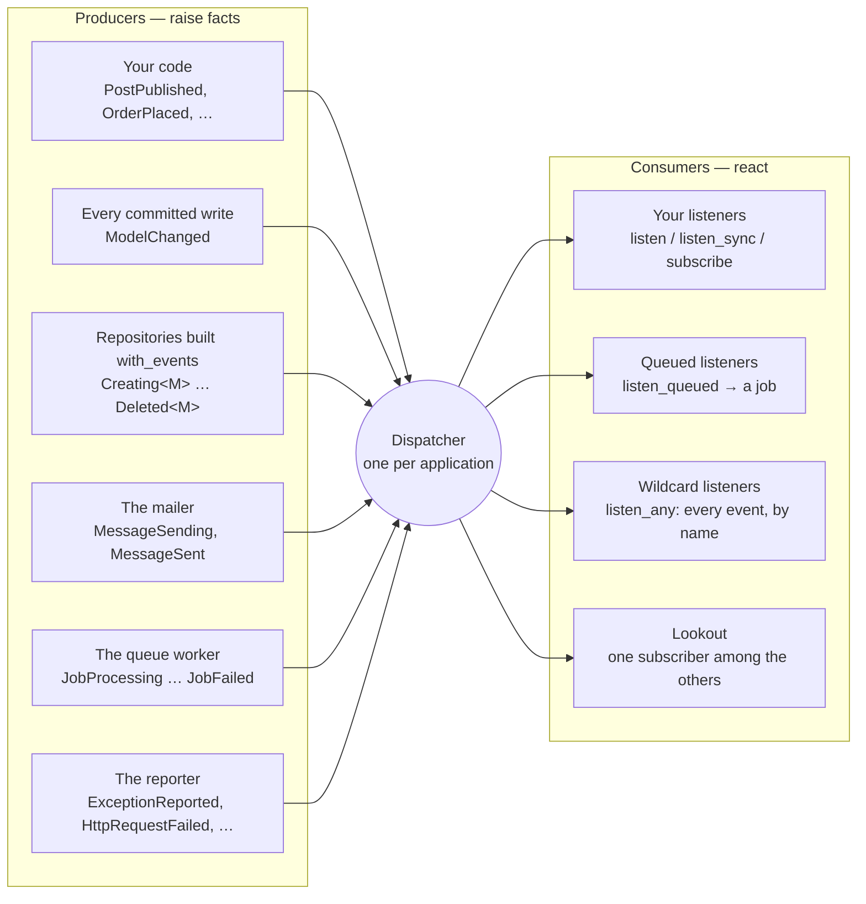
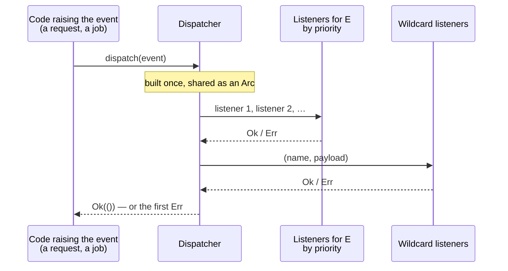
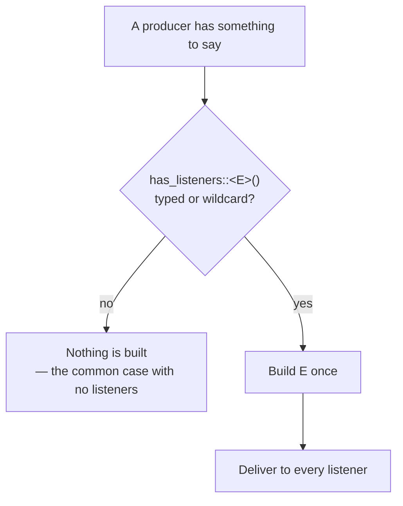
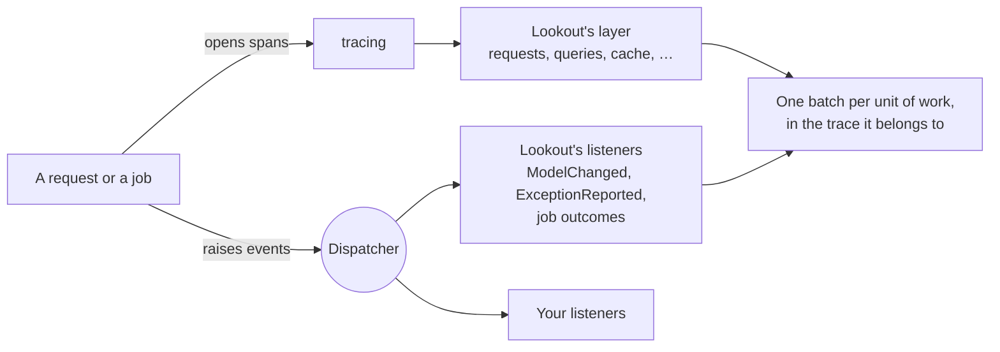
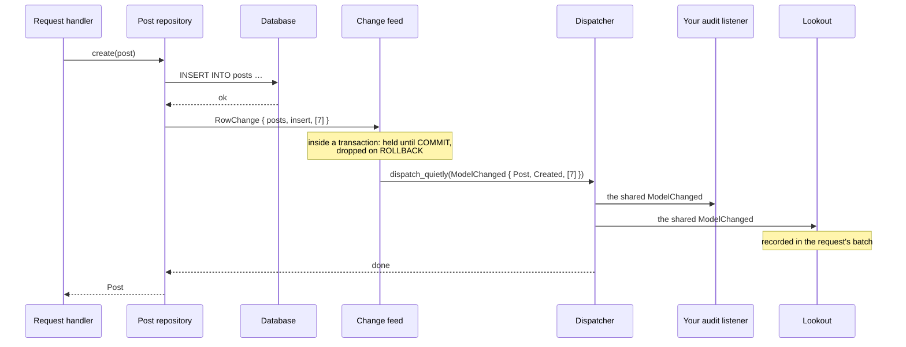
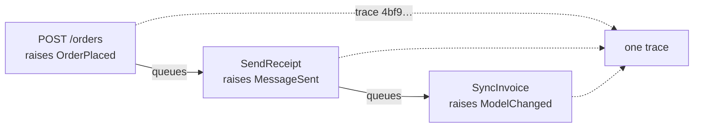
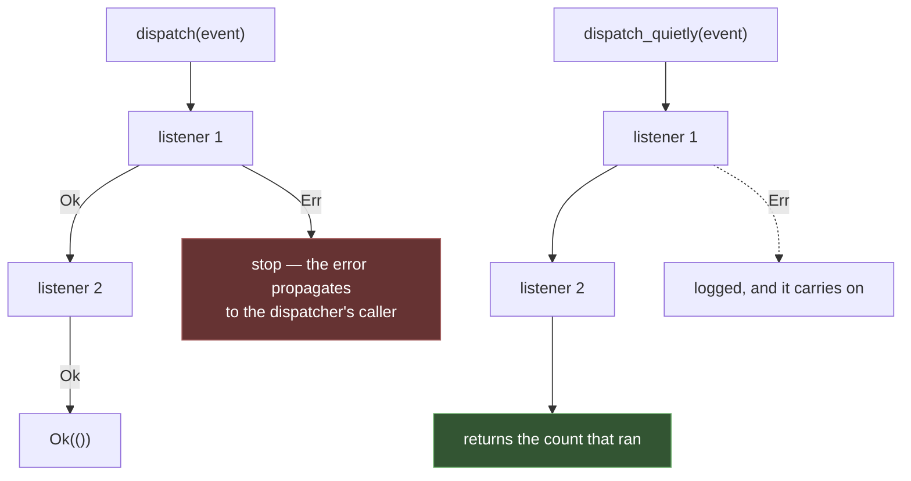

# Events

The dispatcher is Rainier's **event bus** — the seam where something happens and
something else reacts without either knowing about the other. [The bus](#the-bus)
below is how it works and what travels on it; the rest of the page is the API.

Raising one works anywhere. Reacting is done on `events`, the `Dispatcher`
handed to your listener registration at boot — see
[Where listeners are registered](#where-listeners-are-registered):

```rust
// Raise
Event::instance().dispatch(PostPublished { post }).await?;

// React
events.listen(|event: Arc<PostPublished>| async move {
    Queue::instance().dispatch(NotifyAuthor { post_id: event.post.id }).await?;
    Ok(())
});
```

## The bus

An application has **one** `Dispatcher`. Everything raised in it — by your
code or by the framework — goes through that one object, and everything that
reacts registers on it. That is what makes it a bus rather than a set of
callbacks: a producer never names its consumers, a consumer never names its
producer, and either side can be added or removed without touching the other.



Three properties follow from the design, and the rest of this page leans on
them.

### A dispatch runs where it was raised

There is no background thread and no channel in the middle. `dispatch` calls
each listener in turn, on the task that raised the event, and returns when the
last one has finished. The typed listeners for the event run first, highest
`priority` first and then in the order they registered; the wildcard listeners
run after them, in the same order.



Because it runs inline, a listener is **inside the unit of work that raised
the event**: the request's span, its trace id, its scoped bindings. A log line
a listener writes carries the request's trace id; Lookout files what a
listener hears under the request that raised it. It also means a slow listener
slows the request down — which is what [queued listeners](#queued-listeners)
are for.

### Producers and consumers are independent

The framework offers its events to the bus whatever is or is not listening,
and whether or not optional features such as Lookout are compiled in. Nothing
about a listener changes what is offered, and no listener depends on another
being there:

- Your listener for `ModelChanged` works in an application without Lookout.
- Lookout registers its own listeners the same way yours are registered — it
  is one consumer among the others, not part of the bus.
- One listener failing does not stop the others when the event is raised with
  [`dispatch_quietly`](#dispatching), which is how the framework raises the
  events it only announces (`ModelChanged`, the failure reports).

What *is* shared is the cost of building an event. A producer asks
[`has_listeners`](#introspection) first and skips building an event nobody
would hear — and a wildcard listener hears everything, so registering one
(Lookout does) means every event is built.



### Facts, not requests

An event says that something **happened**. It has no recipient and no return
value. If the code raising it needs an answer — did the card charge? — that is
a function call, not an event; see [when to reach for an event](#when-to-reach-for-an-event).

## What travels on the bus

Not everything the framework does is an event. There are two channels, and
knowing which carries what tells you where to hook in.

| | **The bus** — `Dispatcher` | **Spans** — `tracing` |
|---|---|---|
| What it carries | facts with a typed payload | the timing and shape of work |
| Who reads it | listeners: your code, queued jobs, Lookout | the tracing subscriber: logs, an OTLP exporter, Lookout's layer |
| You hook in with | `events.listen(…)` | a `tracing` layer |
| Model writes | `ModelChanged`, and the typed hooks | `db.query` |
| Failures | `ExceptionReported` and one event per kind | `otel.status_code` on the span |
| Jobs | `JobProcessing`, `JobProcessed`, `JobReleased`, `JobFailed` | `queue.process`, `queue.handle`, … |
| Mail | `MessageSending`, `MessageSent` | `mail.send` |
| Requests, queries, cache calls, outgoing HTTP, views, sessions | — | `http.server.request`, `db.query`, `cache.*`, `http.client.request`, … |

The last row is the gap: a request or a query is a span and nothing more, so
there is no event to listen for. Read those through
[observability](observability.md), or through Lookout.

Lookout reads both channels and joins them into one batch per unit of work —
the spans through its tracing layer, the facts through its listeners:



## A model change, end to end

Every write a statement builder or repository makes reports the rows it
touched to the connection's change feed once it has succeeded. Boot connects
each of the application's connections to the bus, so each write becomes one
`ModelChanged` — for every model, from a repository with or without
`with_events`, a bulk update or none:



The typed `Created<Post>` is a separate, older path: it fires only from a
repository built `with_events`, carries the model itself, and a `Creating`
listener can veto the write. See [models](models.md#lifecycle-hooks) for both.

## Across the queue

A dispatch inside a job runs inside that job, as anywhere else. What links a
job to the request that queued it is the trace: the dispatch writes the
request's `traceparent` onto the job, the worker's span records it, and so
every event raised in the job — and in any job that job queues — is heard in
the same trace.



A listener in either job runs in that job's span; Lookout shows the three
batches together on any one of them. See
[observability](observability.md#the-trace-crosses-every-boundary).

## Any type is an event

```rust
impl<T: Send + Sync + 'static> Event for T {}
```

No derive, no registration, no marker trait to implement. A struct is an event
because you dispatched it:

```rust
#[derive(Debug, Clone)]
pub struct PostPublished {
    pub post: Post,
}
```

Keeping events next to the model they concern is a convention worth following
— it puts the vocabulary of the domain in one file.

## Listening

On the `Dispatcher` (`events`); `metrics::increment` stands for whatever
metrics client you use:

```rust
// Async — the usual form.
events.listen(|event: Arc<PostPublished>| async move {
    tracing::info!(id = event.post.id, "published");
    Ok(())
});

// Synchronous, for something trivial.
events.listen_sync(|event: Arc<PostPublished>| {
    metrics::increment("posts.published");
    Ok(())
});

// Ordered — higher priority runs first.
events.listen_with_priority(listener, 100);

// Every event, whatever its type: its name and a type-erased payload.
events.listen_any(|name: &'static str, _event: Arc<dyn Any + Send + Sync>| async move {
    tracing::trace!(event = name, "dispatched");
    Ok(())
});
```

A wildcard listener can `Arc::downcast` the payload when it knows the type, but
most of them — logging, metrics, an audit trail — only need the name.

Listeners receive `Arc<E>`, so several can read the event without cloning it.
That is also **why a listener cannot mutate it** — see
[model hooks](models.md#what-a-hook-can-and-cannot-do) for the same argument in
full.

## Queued listeners

An ordinary listener runs **inside the dispatch**, which means inside the
request that dispatched it. A welcome email sent from a listener is 400ms of
SMTP the person who just signed up waits for, and an SMTP server having a bad
minute becomes a registration endpoint having a bad minute.

The answer is `listen_queued::<E, J>()` plus a `FromEvent` impl saying which
job the event becomes:

```rust
use rainier_framework::{DispatcherExt, FromEvent};

events.listen_queued::<UserRegistered, SendWelcomeEmail>();

impl FromEvent<UserRegistered> for SendWelcomeEmail {
    fn from_event(event: &UserRegistered) -> Self {
        Self { user_id: event.user_id }
    }
}
```

The dispatch now does one queue write and returns. The work happens in a
[worker](queues.md), with retries, backoff and a failed-jobs table — all of
which the inline version has none of.

| | Inline | Queued |
|---|---|---|
| Runs | in the request | in a worker |
| On failure | fails the dispatch | retried, then recorded |
| Sees | the event itself | what `FromEvent` copied out |
| Right for | a counter, a cache invalidation | mail, webhooks, anything over a network |

**The job is built at dispatch, not at handle.** `from_event` runs while the
event is still in hand, and what it copies out is serialised into the payload.
So take an id, not a model: by the time a worker picks the job up, minutes may
have passed and the row may have changed. Re-reading it is the point.

The `QueueManager` is resolved from the container when the event fires, not
when the listener is registered — listeners are registered while the
application is still being built. Dispatching therefore fails with a clear
error if no queue is bound, rather than silently doing nothing: a listener that
quietly stopped queueing is a feature that quietly stopped working.

`listen_queued_on::<E, J>(queue)` takes the queue explicitly, for a test or an
application that does not install the facades.

## Where listeners are registered

```rust
// src/app/providers/mod.rs
impl EventServiceProvider {
    pub fn register_listeners(events: &Dispatcher) {
        events.listen(|event: Arc<PostPublished>| async move {
            Queue::instance().dispatch(NotifyAuthor { post_id: event.post.id }).await?;
            Ok(())
        });
    }
}
```

```rust
Rainier::new(".").with_events(EventServiceProvider::register_listeners)
```

Through the **builder**, not a provider's `register`. The dispatcher is bound
into the container after listeners are added, so `with_events` runs at the
right moment.

### Subscribers

For a group of related listeners:

```rust
pub struct OrderSubscriber;

impl EventSubscriber for OrderSubscriber {
    fn subscribe(&self, events: &Dispatcher) {
        events.listen(|e: Arc<OrderPlaced>| async move { … });
        events.listen(|e: Arc<OrderShipped>| async move { … });
        events.listen(|e: Arc<OrderRefunded>| async move { … });
    }
}
```

```rust
events.subscribe(&OrderSubscriber);
```

One call registers every listener the subscriber declares — no string-keyed
map in the middle.

## Dispatching

```rust
events.dispatch(event).await?;              // Err from any listener propagates
events.dispatch_quietly(event).await;       // returns how many ran; errors logged
events.dispatch_as("legacy.name", event).await?;
```

The difference between the first two is the whole design question, and Rainier
gives you both because the right answer depends on the event:



Use `dispatch` when a listener failing should fail the operation — that is what
makes a [`Creating` hook](models.md#lifecycle-hooks) able to veto a write.

Use `dispatch_quietly` for notifications, where one broken listener should not
take down the request that raised the event.

## Introspection

```rust
events.has_listeners::<PostPublished>();        // typed or wildcard: would anything hear it?
events.has_typed_listeners::<PostPublished>();  // a listener for this type itself
events.forget::<PostPublished>();
events.forget_all();
```

## Testing

```rust
let events = Dispatcher::fake();
app.instance(events);

// … exercise the code …

Event::instance().assert_dispatched::<PostPublished>();
Event::instance().assert_dispatched_times::<PostPublished>(1);
Event::instance().assert_not_dispatched::<PostDeleted>();

let dispatched: Vec<Arc<PostPublished>> = Event::instance().dispatched::<PostPublished>();
let names = Event::instance().dispatched_names();
```

The fake **records instead of calling listeners**. Every assertion panics if
you call it on a real dispatcher, rather than passing vacuously — a test that
asserts `assert_not_dispatched` against a live dispatcher would otherwise pass
for entirely the wrong reason.

`dispatched::<E>()` gives you the events themselves, so you can assert on their
contents:

```rust
let published = Event::instance().dispatched::<PostPublished>();
assert_eq!(published[0].post.title, "Hello");
```

## Events already in the framework

You can listen to these without raising them:

| Event | From |
|---|---|
| `ModelChanged` | [every committed write](models.md#every-write-modelchanged), any model, any repository or none |
| `Creating<M>`, `Created<M>` | [repository writes](models.md#lifecycle-hooks) built `with_events` |
| `Updating<M>`, `Updated<M>` | |
| `Deleting<M>`, `Deleted<M>` | |
| `MessageSending`, `MessageSent` | [the mailer](mail.md) |
| `JobProcessing`, `JobProcessed` | [the worker](queues.md#worker-events) |
| `JobReleased`, `JobFailed` | |
| `HttpRequestFailed`, `JobAttemptFailed`, `CommandFailed`, … | [the reporter](errors.md#reporting) — one event per kind of failure; the full catalogue is there |
| `ExceptionReported` | the reporter — every failure once, whatever its kind |

That is enough to build an audit log, a metrics feed, or a webhook fan-out
without touching the code that does the work.

## When to reach for an event

The question is whether the two sides should know about each other.

**Good:** a controller publishes a post; a listener queues a notification. The
controller does not care that notifications exist, and adding a second reaction
does not touch it.

> Reaching for a [notification](notifications.md) or a
> [broadcast](broadcasting.md) instead? Three different things that compose: an
> event is a **fact** with no recipient, a notification is a **message to a
> person**, and a broadcast is a **push to whoever is connected**. See
> [the table](broadcasting.md#broadcast-event-notification).

**Bad:** a controller dispatches `ChargeCard` and needs to know whether it
worked. That is a **function call**, and dressing it as an event only hides the
dependency and loses the return value.

A rule that holds up: if the raiser needs the outcome, call the thing. If it
genuinely does not, raise an event.
