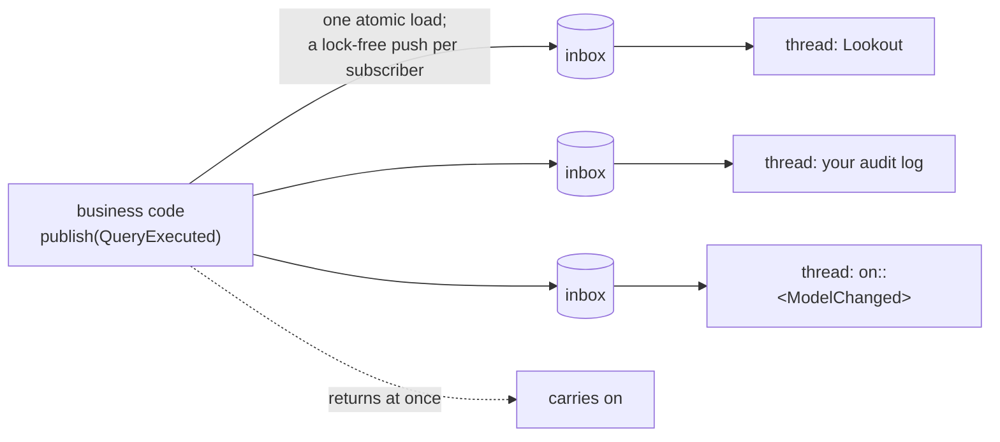
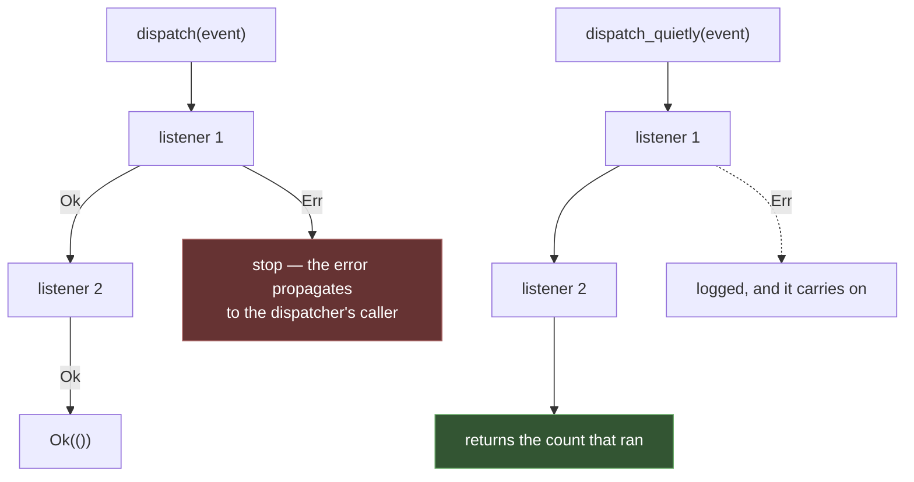

# Events

The dispatcher is the seam where something happens and something else reacts
without either knowing about the other. It carries two kinds of message:
**hooks**, which ask and wait for an answer, and **events**, which tell and
never wait. Everything the framework does is published on it as an event, and
your code subscribes to whatever it wants.

```rust
// Tell: an event. Returns at once; subscribers run later on their own threads.
Event::instance().publish(PostPublished { post_id: post.id });

// React to it.
events.on::<PostPublished>().run(|event, _cx| async move {
    Queue::instance().dispatch(NotifyAuthor { post_id: event.post_id }).await?;
    Ok(())
});
```

Reacting is set up on `events`, the `Dispatcher` handed to your listener
registration at boot. See
[Where listeners are registered](#where-listeners-are-registered).

## Hooks and events: the two ideas

Everything on this page is one of two ideas. The method names come from
history rather than design, so learn the ideas first and then map the names
onto them.

**A hook asks "may I?"** Code stops at a point, asks whoever is registered,
and **waits** for every answer. Any of them can say no:

```rust
// The repository, before inserting a Post:
events.dispatch(Creating { model: post.clone() }).await?;   // waits; an Err cancels the insert

// Your code, registered at boot:
events.listen(|e: Arc<Creating<Post>>| async move {
    if e.model.title.is_empty() {
        return Err(Error::validation("A post needs a title."));
    }
    Ok(())
});
```

A hook runs **inline**, on the request's own task, so it costs the request
exactly as long as the listener takes. That is the point: the caller needs
the answer before it can go on. The framework has four:

| Hook | Can cancel |
|---|---|
| `Creating<M>`, `Updating<M>`, `Deleting<M>` | the database write |
| `MessageSending` | the mail |

**An event says "this happened."** Code announces a fact and carries on
without waiting. Whoever subscribed hears it later, on their own thread, and
cannot affect the code that announced it:

```rust
// The framework, after a query:
publish(QueryExecuted { .. });                        // returns at once

// Your code:
events.on::<QueryExecuted>()
    .when(|q| q.duration > Duration::from_millis(500))
    .run_sync(|q, cx| { slow_queries::record(q, cx.trace_id()); Ok(()) });
```

Everything else the framework raises is an event: requests, queries, cache
calls, jobs, mail sent, `Created<M>`, `ModelChanged` and the rest.

**The tense tells you which.** A present-participle name — `Creating`,
`Sending` — has not happened yet, so it can still be stopped: a hook. A past
tense — `Created`, `Sent`, `Executed`, `Handled` — is done and cannot be
undone: an event.

### Which name is which

| Name | Idea | What it does |
|---|---|---|
| `dispatch(e).await` | hook | ask, wait for every listener; the first `Err` comes back |
| `dispatch_quietly(e).await` | hook, errors ignored | wait for every listener; failures are logged and counted, not returned |
| `listen(..)`, `listen_any(..)` | hook listener | runs **inline** when its event is dispatched — and, if the same event is published instead, on its own thread like a subscriber |
| `publish(e)`, `publish_with(..)` | event | announce; never waits |
| `on::<E>()`, `on_any()`, `subscriber(..)`, `on_activity` | event subscriber | always on its own thread; never inline |
| `Dispatcher` | both | the one registry that holds both |
| `Queue::dispatch(job)` | neither | puts a job on the [queue](queues.md); same word, unrelated |

Rules that follow from it:

- **Raising your own:** `publish` it, unless the code raising it needs the
  listeners' answer. If it needs the answer, `dispatch` it and keep the
  listeners fast. A listener that sends mail or calls an API belongs on an
  event, or behind [a queued listener](#queued-listeners).
- **Reacting:** register a hook listener with `listen` only to veto or check
  before something happens. To react to something that happened, use `on`.
  It never runs on the request's path.
- **A dispatched event still reaches subscribers.** `on` subscribers hear
  dispatched events too, on their own threads, and the dispatch does not wait
  for them. So Lookout sees hooks without slowing them down.

## The bus

Everything the framework does is announced on this dispatcher: every request,
query, cache call, outgoing HTTP call, mail, notification, view, session,
login attempt, broadcast, scheduled task, console command, job, log line and
model write is a typed event. Your code subscribes to the ones it wants.
[Lookout](lookout.md) is one subscriber among them. It has no special access,
and other subscribers neither know nor care that it is there.

There are two ways to raise an event, and the raiser picks:

| | `publish(event)` | `dispatch(event).await` |
|---|---|---|
| Returns | at once — not `async`, nothing to await | after every listener has run |
| Listeners run | later, each subscriber on its own thread | inline, in order, on the raiser's task |
| A listener's `Err` | logged and reported; the raiser never sees it | returned to the raiser (`dispatch_quietly`: logged) |
| Used for | facts: something happened | questions: may this happen? |

The framework publishes everything except the four hooks whose answer it
needs: `Creating<M>`, `Updating<M>`, `Deleting<M>` and `MessageSending`, which
can veto a write or a mail. Those are dispatched.



### A repeater, not a store

`publish` keeps nothing and waits for nothing:

- **With nobody subscribed**, it costs one atomic load. The event is not even
  built if you use `publish_with(|| …)`.
- **With subscribers**, it does one lock-free push onto each subscriber's
  inbox. There is no lock, no `await` and no syscall. The inbox has no
  capacity limit, so nothing is ever dropped and the publisher never waits for
  room.
- **Every subscriber runs on its own OS thread**, started with the first event
  it is sent. One that is slow, stuck or panicking affects only itself. A
  subscriber with more work than one thread keeps up with takes several —
  `subscriber(..).threads(4)` — and each unit of work's events stay together
  on one of them, in order, its `UnitCompleted` last.
- **The publisher never wakes a subscriber's thread**, because waking a
  sleeping thread is a syscall. The subscriber thread checks its inbox itself:
  continuously while events arrive, and about every millisecond once idle. So
  after a quiet spell an event can reach a subscriber up to a millisecond late.
  That delay falls on the subscriber, never on your request.

Measured on an Apple-silicon laptop, release build, on the publishing thread
(`cargo test -p rainier-events --release --test publish_cost -- --ignored --nocapture`):

| | per publish, in a request | a request of 20 queries + 3 cache calls | per publish, a million back to back |
|---|---|---|---|
| nobody subscribed | 5 ns | 0.1 µs | 5 ns |
| one subscriber | 120–170 ns | 2.8–3.9 µs | ~210 ns |
| three async subscribers and a wildcard | ~180 ns | ~4.3 µs | ~490 ns |

With Lookout subscribed, recording that same request costs its thread about
5 µs (`cargo test -p rainier-lookout --release --test hot_path_cost --
--ignored --nocapture`); Lookout does the rest on its own threads.
Lookout's old `tracing` layer cost the request's thread about 59 µs.

### Subscribing

```rust
// One event, one handler, its own thread.
events.on::<OrderShipped>()
    .when(|e| e.total_cents > 10_000)          // runs on the subscriber's thread
    .run(|e: Arc<OrderShipped>, cx: Context| async move {
        audit::record("big order", e.order_id, cx.trace_id()).await
    });

// A component watching many events: one thread for all its handlers.
events.subscriber("metrics")
    .on(|q: &QueryExecuted, _cx| { metrics::histogram("db", q.duration); Ok(()) })
    .on(|c: &CacheOperation, _cx| { metrics::increment(c.kind()); Ok(()) })
    .start();

// One model, one row: the declarative form of "tell me when user 42 changes".
events.on_model::<User>().key(42).actions(&[ModelAction::Updated])
    .run(|change, _cx| async move { refresh_profile_card(change).await });
```

`.run` takes an async handler, which runs on the subscriber's own runtime.
`.run_sync` and `subscriber(..).on(..)` take a plain closure, which runs on
the subscriber's thread. Use them for quick work such as counting or
recording into memory. An ordinary `listen` listener works on both paths: it
runs inline when its event is dispatched, and on its own thread when it is
published.

### Context: which request is this?

A subscriber runs later and on another thread, so it can't learn which
request or job an event came from by looking around. The publisher records
that at publish time, and it travels with the event as a `Context`:

- **`cx.unit()`** is the unit of work: an HTTP request, one attempt of a job,
  a console command or a scheduled task. It carries the unit's id, kind, name,
  path, trace id and `traceparent`. A job queued from a request continues the
  request's trace, so a request, the job it queued and the job that job
  queued share one trace id.
- **`cx.parent()`** is the operation the event ran inside. For example, a view
  rendered while a mail is sent names the mail.
- **`UnitCompleted`** is published once a unit is over **and** every event
  raised in it has been handled by every subscriber. A subscriber that
  gathers a unit's events closes on it, and never sees a straggler after it.

The framework opens units itself. If your code `tokio::spawn`s work that
belongs to the current request, carry the context with it:
`tokio::spawn(Context::current().scope(work))`.

### Activities: everything at once

Each framework event also describes itself as an `Activity`. It has a
`kind()` (`db.query`, `cache.get`, `http.server.request`, … — the names of the
framework's `tracing` spans), its `fields()` under the same OpenTelemetry
names, a `duration()` and `failed()`. A subscriber that wants everything the
framework does without naming every type, as Lookout does, uses
`subscriber(..).on_activity(..)`. Publish your own activities with
`publish_activity` and they appear there too.

`tracing` spans are unchanged. They still feed OpenTelemetry exporters and
logs. The bus and the spans are two outputs of the same instrumentation, and
neither depends on the other.

### The bus, broadcasting, notifications and the queue

Four mechanisms that all mean "tell someone", and they don't overlap:

| | Reaches | Leaves the process? | Durable? | Use it for |
|---|---|---|---|---|
| **Event bus** (`publish`, `on`) | code in this process that subscribed | no | no — a repeater; gone once delivered | reacting to what happened: metrics, audit, cache invalidation, Lookout |
| **Hooks** (`dispatch`, `listen`) | listeners in this process, inline | no | no | a decision the raiser waits for: veto a write |
| [**Broadcast**](broadcasting.md) | browsers subscribed to a channel | yes, over WebSockets | no — best-effort | "the page should update" |
| [**Notification**](notifications.md) | one named person | yes — mail, SMS, a row | per channel | "tell Ada her order shipped" |
| [**Queue**](queues.md) | a worker, later | via the queue's store | yes — retried, recorded | work that must happen: send the mail, call the webhook |

They compose. A subscriber on the bus can queue a job, the job sends a
notification, and the notification broadcasts so the bell moves. Each step is
also an event on the bus.

## Any type is an event

```rust
impl<T: Send + Sync + 'static> Event for T {}
```

No derive, no registration, no marker trait to implement. A struct is an event
because you dispatched it:

```rust
#[derive(Debug, Clone)]
pub struct PostPublished {
    pub post: Post,
}
```

Keeping events next to the model they concern is a convention worth following
— it puts the vocabulary of the domain in one file.

## Listening

On the `Dispatcher` (`events`); `metrics::increment` stands for whatever
metrics client you use:

```rust
// Async — the usual form.
events.listen(|event: Arc<PostPublished>| async move {
    tracing::info!(id = event.post.id, "published");
    Ok(())
});

// Synchronous, for something trivial.
events.listen_sync(|event: Arc<PostPublished>| {
    metrics::increment("posts.published");
    Ok(())
});

// Ordered — higher priority runs first.
events.listen_with_priority(listener, 100);

// Every event, whatever its type: its name and a type-erased payload.
events.listen_any(|name: &'static str, _event: Arc<dyn Any + Send + Sync>| async move {
    tracing::trace!(event = name, "dispatched");
    Ok(())
});
```

A wildcard listener can `Arc::downcast` the payload when it knows the type, but
most of them — logging, metrics, an audit trail — only need the name.

Listeners receive `Arc<E>`, so several can read the event without cloning it.
That is also **why a listener cannot mutate it** — see
[model hooks](models.md#what-a-hook-can-and-cannot-do) for the same argument in
full.

## Queued listeners

An ordinary listener runs **inside the dispatch**, which means inside the
request that dispatched it. A welcome email sent from a listener is 400ms of
SMTP the person who just signed up waits for, and an SMTP server having a bad
minute becomes a registration endpoint having a bad minute.

The answer is `listen_queued::<E, J>()` plus a `FromEvent` impl saying which
job the event becomes:

```rust
use rainier_framework::{DispatcherExt, FromEvent};

events.listen_queued::<UserRegistered, SendWelcomeEmail>();

impl FromEvent<UserRegistered> for SendWelcomeEmail {
    fn from_event(event: &UserRegistered) -> Self {
        Self { user_id: event.user_id }
    }
}
```

The dispatch now does one queue write and returns. The work happens in a
[worker](queues.md), with retries, backoff and a failed-jobs table — all of
which the inline version has none of.

| | Inline | Queued |
|---|---|---|
| Runs | in the request | in a worker |
| On failure | fails the dispatch | retried, then recorded |
| Sees | the event itself | what `FromEvent` copied out |
| Right for | a counter, a cache invalidation | mail, webhooks, anything over a network |

**The job is built at dispatch, not at handle.** `from_event` runs while the
event is still in hand, and what it copies out is serialised into the payload.
So take an id, not a model: by the time a worker picks the job up, minutes may
have passed and the row may have changed. Re-reading it is the point.

The `QueueManager` is resolved from the container when the event fires, not
when the listener is registered — listeners are registered while the
application is still being built. Dispatching therefore fails with a clear
error if no queue is bound, rather than silently doing nothing: a listener that
quietly stopped queueing is a feature that quietly stopped working.

`listen_queued_on::<E, J>(queue)` takes the queue explicitly, for a test or an
application that does not install the facades.

**How the event is raised decides when the queue write happens.** A queued
listener is registered with `listen`, so it is an inline listener like any
other:

- **`dispatch(event).await`** runs it inline. The job is on the queue when
  `dispatch` returns, and a write the queue refuses is `dispatch`'s error.
- **`publish(event)`** runs it later, on its own thread. The queue write is
  fire and forget: a refused write is logged and reported as a failed listener
  (`ListenerFailed`), never returned, because `publish` has nothing to return
  it through.

Dispatch an event whose queued work must not be lost without the caller
knowing.

## Where listeners are registered

```rust
// src/app/providers/mod.rs
impl EventServiceProvider {
    pub fn register_listeners(events: &Dispatcher) {
        events.listen(|event: Arc<PostPublished>| async move {
            Queue::instance().dispatch(NotifyAuthor { post_id: event.post.id }).await?;
            Ok(())
        });
    }
}
```

```rust
Rainier::new(".").with_events(EventServiceProvider::register_listeners)
```

Through the **builder**, not a provider's `register`. The dispatcher is bound
into the container after listeners are added, so `with_events` runs at the
right moment.

### Grouping listeners: `EventSubscriber`

For a group of related listeners:

```rust
pub struct OrderSubscriber;

impl EventSubscriber for OrderSubscriber {
    fn subscribe(&self, events: &Dispatcher) {
        events.listen(|e: Arc<OrderPlaced>| async move { … });
        events.listen(|e: Arc<OrderShipped>| async move { … });
        events.listen(|e: Arc<OrderRefunded>| async move { … });
    }
}
```

```rust
events.subscribe(&OrderSubscriber);
```

One call registers every listener the subscriber declares — no string-keyed
map in the middle.

## Dispatching

```rust
events.publish(event);                      // fire and forget — see "The bus"
events.dispatch(event).await?;              // Err from any listener propagates
events.dispatch_quietly(event).await;       // returns how many failed; errors logged
events.dispatch_as("legacy.name", event).await?;
```

`publish` is the default for anything that has *happened*. The two
`dispatch` forms are for the rarer event whose raiser waits on its listeners.
A dispatched event still reaches the bus's subscribers (`on`, `subscriber`) —
on their own threads, without the raiser waiting for them.

The difference between the first two is the whole design question, and Rainier
gives you both because the right answer depends on the event:



Use `dispatch` when a listener failing should fail the operation — that is what
makes a [`Creating` hook](models.md#lifecycle-hooks) able to veto a write.

Use `dispatch_quietly` for notifications, where one broken listener should not
take down the request that raised the event.

## Introspection

```rust
events.has_listeners::<PostPublished>();
events.forget::<PostPublished>();
events.forget_all();
```

## Testing

```rust
let events = Dispatcher::fake();
app.instance(events);

// … exercise the code …

Event::instance().assert_dispatched::<PostPublished>();
Event::instance().assert_dispatched_times::<PostPublished>(1);
Event::instance().assert_not_dispatched::<PostDeleted>();

let dispatched: Vec<Arc<PostPublished>> = Event::instance().dispatched::<PostPublished>();
let names = Event::instance().dispatched_names();
```

The fake records published events as well as dispatched ones. With a real
dispatcher, `events.settled().await` waits until every published event has
been handled by every subscriber — for tests only; production code never waits
on the bus.

The fake **records instead of calling listeners**. Every assertion panics if
you call it on a real dispatcher, rather than passing vacuously — a test that
asserts `assert_not_dispatched` against a live dispatcher would otherwise pass
for entirely the wrong reason.

`dispatched::<E>()` gives you the events themselves, so you can assert on their
contents:

```rust
let published = Event::instance().dispatched::<PostPublished>();
assert_eq!(published[0].post.title, "Hello");
```

## Events already in the framework

You can listen to these without raising them:

| Event | From |
|---|---|
| `ModelChanged` | [every committed write](models.md#every-write-modelchanged), any model, any repository or none |
| `Creating<M>`, `Created<M>` | [repository writes](models.md#lifecycle-hooks) built `with_events` |
| `Updating<M>`, `Updated<M>` | |
| `Deleting<M>`, `Deleted<M>` | |
| `MessageSending`, `MessageSent` | [the mailer](mail.md) |
| `JobProcessing`, `JobProcessed` | [the worker](queues.md#worker-events) — published, so their listeners run after the worker has moved on |
| `JobReleased`, `JobFailed` | |
| `RequestHandled` (`http.server.request`) | the HTTP kernel, once per request — the root activity of the request's unit |
| `JobQueued` (`queue.publish`), `JobRan` (`queue.process`) | every dispatch; every job attempt — the root of the attempt's unit, or an operation in the request it ran inside |
| `CommandRan` (`console.command`) | the console, once per command — the root of the command's unit |
| `ScheduledTaskRan` (`schedule.task`) | the scheduler, once per due task, skipped ones included — the root of the task's unit |
| `HttpRequestFailed`, `JobAttemptFailed`, `CommandFailed`, … | [the reporter](errors.md#reporting) — one event per kind of failure; the full catalogue is there |
| `ExceptionReported` | the reporter — every failure once, whatever its kind |

That is enough to build an audit log, a metrics feed, or a webhook fan-out
without touching the code that does the work.

## When to reach for an event

The question is whether the two sides should know about each other.

**Good:** a controller publishes a post; a listener queues a notification. The
controller does not care that notifications exist, and adding a second reaction
does not touch it.

> Reaching for a [notification](notifications.md) or a
> [broadcast](broadcasting.md) instead? Three different things that compose: an
> event is a **fact** with no recipient, a notification is a **message to a
> person**, and a broadcast is a **push to whoever is connected**. See
> [the table](broadcasting.md#broadcast-event-notification).

**Bad:** a controller dispatches `ChargeCard` and needs to know whether it
worked. That is a **function call**, and dressing it as an event only hides the
dependency and loses the return value.

A rule that holds up: if the raiser needs the outcome, call the thing. If it
genuinely does not, raise an event.
