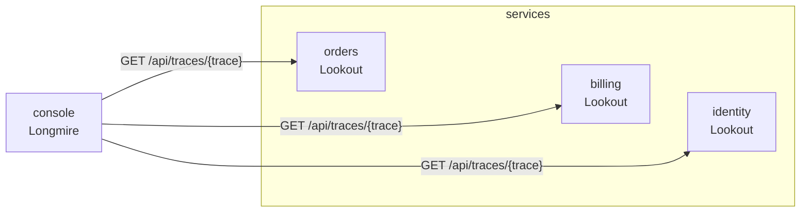

# Longmire

Longmire is one view across many [Lookouts](lookout.md). Each service's
Lookout records its own work; Longmire, in the one application that can reach
all of them — an operations console — asks every one at once for its part of
a request, and links the parts into one tree: each service's work under the
call that reached it.

Lookouts never talk to one another. Each records its own side and serves it;
Longmire is where the reports come together.



## What it needs from each service

Lookout's [request tracing](lookout.md#traces-across-services) on
(`LOOKOUT_REQUEST_TRACING=true`), which turns on
[request tagging](observability.md#request-tagging), and a Lookout
[reader](lookout.md#readers-another-service) that accepts the console's
credentials. Request tracing records, on each side, the span id every call put
on the wire: the caller's batch as the call's `call.span_id`, the callee's as
its `remote_parent_span_id`. That shared id is all Longmire links on.

## Turning it on

Build with the `longmire` feature (it brings the HTTP client's real
transport), and bind it in the console: which Lookouts, and how to sign in to
each.

```rust
use rainier_framework::longmire::{Longmire, Source};

let longmire = Longmire::new([
    Source::new("orders", "http://orders.internal"),
    Source::new("billing", "http://billing.internal").path("/ops/lookout").name("Billing"),
])
// The bearer token each Lookout's reader accepts — a service token, typically.
.credentials(|source| {
    let audience = source.id.clone();
    Box::pin(async move { service_tokens().for_audience(&audience).await })
});
```

Sources can come from configuration as JSON — `Longmire::from_json(&env)` over
`[{"id", "name"?, "url", "path"?}]`. `path` is where the service mounts
Lookout, `/_lookout` by default. A source with no id or no http(s) URL, or a
repeated id, is dropped. A credentials callback that answers `None` leaves
that source out of the answer, named, rather than calling it unsigned.

## Reading

| Call | Answers |
|---|---|
| `longmire.trace(id)` | `{trace_id, started_at, services, batches, unanswered}` — every source's part, linked |
| `longmire.recent(&RecentQuery { kept, before, limit })` | `{services, traces}` — the latest traces that crossed services, one row per trace, newest first, at most 50 |

The id is a trace id as Lookout keys it, or a UUID as a frontend that started
the trace with [`REQUEST_TAGGING_HEADER`](observability.md#request-tagging)
shows it — dashes and all.

Every source is asked at once, each within eight seconds (`.timeout(…)`). In
`services`, each source is `ok` with how many parts it gave, or `unknown` with
the reason — it did not answer, it answered 404 (request tracing off, no
reader, or credentials it does not take), or it refused them.

### How the parts are linked

In `batches`, every batch carries its source (`service`, `service_name`) and
is placed under the outbound call whose `call.span_id` equals its
`remote_parent_span_id`; a batch with no such call is a root. They come in
tree order — each followed by the ones under it, both by start time — with a
`depth`, and `parent` naming the call (`{call_span_id, span_id}`). A batch's
`spans` are its own: type, summary, start, duration, failed, slow, and for an
outbound call its `call` (`span_id`, `host`, `status`). Never content: that
never leaves a Lookout.

`unanswered` lists the calls that carried the trace and that no batch here
answered: into a service that let its part go, one that is not a source, or
another company's API.

```text
orders    POST /checkout 502 ──┬─ query …
                               └─ POST billing/charges 500   call.span_id = S1
billing   POST /charges 500       remote_parent_span_id = S1 ─┘
unanswered: POST api.payments.example/v1/charges (from billing)
```

## Routes

To serve the same answers as JSON, mount `longmire::routes` with a check of
your own over who may read; anyone it refuses gets the router's 404.

```rust
let router = rainier_framework::longmire::routes(
    Arc::new(longmire),
    Arc::new(|request| {
        let staff = is_staff(request);
        Box::pin(async move { staff })
    }),
);
app_router.group(GroupAttributes::new().prefix("/ops/longmire"), |r| r.merge(router));
```

`GET /traces` (`kept`, `before`, `limit`) and `GET /traces/{trace}`, each
answering `{"data": …}`; a malformed trace id is a `400`. An application with
its own response envelope or access rules can call `trace` and `recent` from
its own handlers instead.

## Limits

- Longmire keeps nothing: each answer is assembled from what the Lookouts
  hold now, so a trace is there as long as each service keeps its batches.
- A part a service did not keep is missing; the call into it is still in its
  caller's part, and in `unanswered`.
- The sources' clocks are their own: start times across services are only as
  close as the services' clocks.
