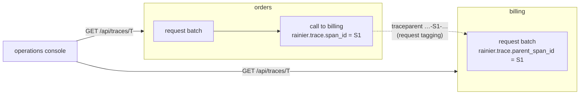

# Lookout

Lookout is Rainier's opt-in diagnostics suite. It records what each unit of
work did — a request, a job, a console command, a scheduled task — as a
**batch** of entries: the queries it ran, the cache it touched, the calls it
made out, the jobs it queued, the mail it sent, the failures it reported, and
how long each took. You open `/_lookout` and look.

"Batch" is the storage word — the unit Lookout keeps or drops, with
everything in it — and the API's (`/api/batches`). The dashboard calls each
by what it is: a **request** at `/_lookout/requests/<id>`, a **job** at
`/jobs/<id>`, a **page view** at `/page-views/<id>`, an **API call** seen
from the browser at `/api-calls/<id>`. `/_lookout/batches/<id>` opens any of
them, for a link that knows only the id.

It is built from what the framework already emits. Every component publishes
what it did — a query, a cache call, a job run, the request itself — on the
[event bus](events.md) as an activity, in the unit of work (request, job,
command, scheduled task) it did it in; failures, model changes and the end of
each unit travel the same way. Lookout is one subscriber of that bus,
`lookout`, on a thread of its own. Log lines reach the bus through
`rainier_events::log_layer`, which boot adds to the tracing subscriber. No
application code opens anything for it.

Run the example to see it end to end, offline, from a checkout of this
repository:

```sh
cargo run -p rainier-framework --example lookout --features lookout
```

---

## Turning it on

Add `lookout` to the framework's features in `Cargo.toml` (the dependency is
declared as [Installation](installation.md#adding-rainier-to-an-existing-crate)
shows):

```toml
[dependencies]
rainier-framework = { version = "2", features = ["sea-orm-executor", "lookout"] }
```

and switch it on in `.env` or the process environment:

```env
LOOKOUT_ENABLED=true
```

That is all a deployment needs. [`cargo rainier features`](deployment.md#sizing-the-image) turns the feature on
for an environment that sets `LOOKOUT_ENABLED=true`, as it does `telemetry`
for `TELEMETRY_ENABLED=true`.

The feature also compiles in the framework's spans, **without** the OTLP
exporter. Lookout and `telemetry` are independent: turn both on to keep
Lookout and export the same work to a collector as spans.

### The environment

Read at boot through the application's `Env` (so `.env` counts), with
`APP_ENV` taken from the configuration:

| Variable | Sets | Accepts | Default |
|---|---|---|---|
| `LOOKOUT_ENABLED` | the master switch | a boolean | `false` |
| `LOOKOUT_STORE` | where batches go | `memory`, `database`, `cache` | `memory` |
| `LOOKOUT_CONNECTION` | the database store's connection | a connection name | the default connection |
| `LOOKOUT_CACHE_STORE` | the cache store's store | a cache store name | the default store |
| `LOOKOUT_CAPACITY` | how many batches the cache store keeps | a positive integer | `1000` |
| `LOOKOUT_PATH` | the dashboard's path | a path starting `/` | `/_lookout` |
| `LOOKOUT_GUARD` | the guard that authenticates viewers | a guard name | the default guard |
| `LOOKOUT_REQUEST_SAMPLE_RATE` | the fraction of requests recorded | `0.0..=1.0` | `1.0` |
| `LOOKOUT_JOB_SAMPLE_RATE` | the fraction of jobs recorded | `0.0..=1.0` | `1.0` |
| `LOOKOUT_COMMAND_SAMPLE_RATE` | the fraction of commands and tasks recorded | `0.0..=1.0` | `1.0` |
| `LOOKOUT_SLOW_QUERY_MS` | a slow query | milliseconds | `100` |
| `LOOKOUT_SLOW_REQUEST_MS` | a slow request | milliseconds | `1000` |
| `LOOKOUT_LOG_LEVEL` | the lowest log level recorded | `off`, `error`, `warn`, `info`, `debug`, `trace` | `error` |
| `LOOKOUT_RETENTION_HOURS` | how long raw batches are kept | a positive integer | `24` |
| `LOOKOUT_AGGREGATE_RETENTION_DAYS` | how long aggregates are kept | a positive integer | `30` |
| `LOOKOUT_CAPTURE_REQUEST_HEADERS` | [opt-in capture](#privacy) | a boolean | `false` |
| `LOOKOUT_CAPTURE_REQUEST_BODY` | every kept request's body, redacted ([privacy](#privacy)) | a boolean | `false` |
| `LOOKOUT_CAPTURE_RESPONSE_BODY` | every kept request's response body, redacted | a boolean | `false` |
| `LOOKOUT_CAPTURE_MAX_BODY_BYTES` | the most of a body kept | a positive integer | `65536` |
| `LOOKOUT_CAPTURE_REQUEST_BODY_ON_EXCEPTION` | | a boolean | `false` |
| `LOOKOUT_CAPTURE_BODIES_EXCEPT` | routes whose bodies are never kept ([privacy](#privacy)) | comma-separated globs over the route name or pattern | none |
| `LOOKOUT_MASK_SECRETS` | star out values that look like keys and tokens ([privacy](#privacy)) | a boolean | `true` |
| `LOOKOUT_STREAM` | "Live" streams new batches and moving counts ([live](#live)) instead of polling | a boolean | `true` |
| `LOOKOUT_CAPTURE_CACHE_KEYS` | | a boolean | `false` |
| `LOOKOUT_CAPTURE_MAIL` | | a boolean | `false` |
| `LOOKOUT_CAPTURE_USER_ID` | | a boolean | `false` |
| `LOOKOUT_CAPTURE_USER` | who made a request, as the application [describes them](#who-made-a-request) | a boolean | `false` |
| `LOOKOUT_CAPTURE_CLIENT` | [what made it](#what-made-a-request): address, browser, system, device, page | a boolean | `false` |
| `LOOKOUT_CAPTURE_CLIENT_IP` | how much of the client's address is kept | `partial`, `full`, `none` | `partial` |
| `LOOKOUT_RUM` | [real user monitoring](#real-user-monitoring): the browser's view of each request | a boolean | `false` |
| `LOOKOUT_RUM_ORIGINS` | the frontends allowed to report, and to read detailed timing | comma-separated origins | none |
| `LOOKOUT_RUM_SAMPLE_RATE` | the fraction of page views that report | `0.0..=1.0` | `0.1` |
| `LOOKOUT_RUM_SLOW_MS` | a request this slow in the browser is reported whatever the sample | milliseconds | `1000` |
| `LOOKOUT_RUM_SECRET` | the key reports are signed with | a string | derived from `APP_KEY` |
| `LOOKOUT_RUM_HOLD_SECONDS` | how long a request from a frontend is held for a browser report to [pair](#pairing) with | an integer; `0` holds none | `120` |
| `LOOKOUT_RUM_COUNTRY_HEADER` | the request header a proxy puts the visitor's country in, for the [RUM rollups](#rum-rollups)' `country` (`cf-ipcountry` behind Cloudflare) | a header name | none: every report is `unknown` |
| `LOOKOUT_RUM_REPLAY` | [session replay](#session-replay), masked, around failures | a boolean | `false` |
| `LOOKOUT_RUM_REPLAY_MODE` | upload around failures only, or the whole page view | `errors`, `always` | `errors` |
| `LOOKOUT_RUM_REPLAY_EXCEPT` | pages never recorded | comma-separated globs over the page's path | none |
| `LOOKOUT_RUM_REPLAY_CONSENT` | whether a page records before it says the visitor agreed | `required`, `implied` | `required` |
| `LOOKOUT_RUM_REPLAY_MAX_BYTES` | the most one recording may weigh, compressed | a positive integer | `262144` |
| `LOOKOUT_CAPTURE_CLIENT_ERRORS` | record a request's 4xx as an exception ([below](#client-errors-are-not-failures)) | a boolean | `false` |
| `LOOKOUT_CAPTURE_CODE_TRACES` | where a slow query or call came from ([below](#code-traces)) | a boolean | `true` |
| `LOOKOUT_INSIGHTS_ENABLED` | the dashboard's [insights and forecasts](#insights-and-forecasts) | a boolean | `true` |
| `LOOKOUT_INSIGHTS_WINDOW_MINUTES` | the window compared with the one before | `1..=10080` | `60` |
| `LOOKOUT_INSIGHTS_MIN_COUNT` | how many a key needs before a change in it is reported | a positive integer | `5` |
| `LOOKOUT_INSIGHTS_CHANGE_PERCENT` | the smallest change reported | a positive integer | `50` |
| `LOOKOUT_INSIGHTS_FORECAST_BUCKETS` | how many buckets a forecast reaches; `0` draws none | `0..=100` | `6` |
| `LOOKOUT_REQUEST_TRACING` | [request tracing](#traces-across-services): keep traces that cross services whole, and let readers read their shape | a boolean | `false` |
| `LOOKOUT_TRACE_SAMPLE_RATE` | in request tracing, the fraction of traces kept whole, decided from the trace id so every service agrees | `0.0..=1.0` | `0.01` |
| `LOOKOUT_SERVICE` | the name this service goes by in a trace | a string | `APP_NAME` |
| `APP_ENV` | `local` when it is `local` | — | — |

Booleans accept `true`/`false`, `1`/`0`, `yes`/`no`, `on`/`off`; an empty
variable counts as unset. **Anything else fails the boot**, with the variable,
its value and what it accepts in the message — the same as a misspelled
`QUEUE_DRIVER`. A typo in a deployment should stop it, not record nothing.

### In code

The environment sets the scalars. Scope, per-watcher rules and the keep rule
are about the application's own routes, so they are code, on the builder in
your boot code:

```rust
use rainier_framework::lookout::config::{Patterns, Scope, WatcherConfig};
use rainier_framework::lookout::EntryType;

Rainier::new(".")
    .with_lookout(|lookout| {
        lookout
            .scope(Scope {
                routes: Patterns { include: vec![], exclude: vec!["health".into()] },
                jobs: true,
                commands: true,
                scheduled_tasks: true,
                ..Scope::default()
            })
            .watch(EntryType::Cache, |w| WatcherConfig { sample_rate: 0.1, ..w })
            .disable(EntryType::View)
            .keep_batch_if(|batch| batch.has_exception || batch.duration_us > 250_000)
    })
```

`with_lookout` runs **after** the environment is read, so what it sets wins;
called more than once, the adjustments apply in order. It does not turn
Lookout on by itself — `LOOKOUT_ENABLED` does, or `.enabled(true)` in the
closure. The result is validated again, and a sample rate outside `0.0..=1.0`
fails the boot like a bad variable.

---

## What it records

### Scope and sampling

A batch is decided in two stages. When the work starts, the **route** (its
name, else its pattern, else the raw path) and whether jobs, commands and
tasks are watched at all decide whether to buffer anything — the cheap
rejection, made before the handler runs, so an excluded route's queries are
never buffered. When the work ends, the **guard** and **user** — known only
once authentication has run — decide whether to keep it.

Sampling is per kind of work (`request_sample_rate`, `job_sample_rate`,
`command_sample_rate`) and per watcher (`WatcherConfig::sample_rate`).
**Failures ignore both**: a failure with no batch around it gets a batch of
its own, so nothing reported is lost to scoping or sampling. A batch carrying
one of `scope.monitored_tags` is kept whatever the sampling — tag a batch from
code with `Lookout::tag(None, "watch:user-42")`.

The dashboard's own path is never recorded.

### What is kept

With no `keep_batch_if`, a batch is kept when `APP_ENV=local`, or — anywhere
else — when it has an exception, something slow, a failed job or a monitored
tag. Production keeps the interesting batches and lets the rest go.

**Kept or not, every batch in scope is counted.** The ones the rule lets go
are not stored, but their entries are rolled into the aggregates like any
other, so a route's count, throughput and p50 to p99 describe every request
to it — not only the slow and failed ones that were kept. (Before this, the
aggregates were rolled from kept batches only, which made every percentile
read high in production.) A batch out of scope is counted nowhere.

### Thresholds

Each watcher has a `slow_ms`, and per-pattern `slow_overrides` keyed by a glob
over the entry's family key (route name, job name, …). A slow entry is tagged
`slow` and gets a derived `slow` entry. Queries default to 100 ms; requests,
jobs and outbound HTTP calls to 1000 ms.

### N+1 detection

A run of at least `n_plus_one.min_repeats` (5) queries with the same sanitised
SQL in one batch, taking at least `n_plus_one.min_total_ms` (50 ms) together,
adds an `n_plus_one` entry naming the query.

### Client errors are not failures

The framework's reporter puts every error on the event bus, a `404` or a
`422` included, because some listener may want them. Lookout does not: a
request answered with a client error is recorded with its status, but it adds
no exception entry, does not flag the batch as failed, and does not open a
[case](#cases). A WebSocket whose handler refused its client with a client
error — a revoked token, a channel it may not join — is treated the same way.
`LOOKOUT_CAPTURE_CLIENT_ERRORS=true` records them. A client
error inside a job or a command — a `NotFound` for a row that should exist —
is always recorded: there it is the application's fault.

### Code traces

An exception carries its backtrace when the error captured one
(`RUST_BACKTRACE=1`; in a release build, server errors only — see
[errors](errors.md)), and its content gains `frames`: the application's own
frames — framework, runtime and standard-library frames left out — as
`{"function", "file", "line"}`, innermost first.

A slow query, cache call, outgoing request, mail, notification or view gets
`code.trace` in the same shape: the stack **as the work finishes**. Lookout
asks publishers (`rainier_events::code_trace::request_code_traces`) for a
stack over the lowest slow threshold of those watchers, and the publisher —
the database, the cache — captures it on the thread that did the work, inside
the code that awaited it, so those frames are where the call came from. Only
work over the threshold is traced, because a capture walks the stack; fast
work costs nothing. `LOOKOUT_CAPTURE_CODE_TRACES=false` turns it off.

The request pays only for the walk, once per family per unit of work — a
request running the same slow query five hundred times gets one trace, not
five hundred walks — and Lookout keeps at most `MAX_CODE_TRACES_PER_BATCH`
(16) families per batch. A watcher with a `slow_overrides` entry above its
base threshold can miss a trace for the overridden family: the request goes
out at the lowest threshold, but the publisher claims the family's one trace
before Lookout sees whether the entry is slow. Turning the addresses into function names, which costs several times
the walk, is the background writer's job, on a blocking thread, just before
the batch is stored.

Both need symbols. A stripped binary renders every frame as `<unknown>`, which
gives no frames; function names need the symbol table, and files and lines
need line tables (`[profile.release] debug = "line-tables-only"`).

### Entry types

`request`, `query`, `cache`, `http_client`, `job`, `mail`, `notification`,
`event`, `scheduled_task`, `command`, `exception`, `log`, `model`, `view`,
`broadcast`, `session`, `auth_attempt`, `n_plus_one`, `slow`, `custom`. The
activity kind each comes from is catalogued in `rainier_lookout::subscriber`.

Four more exist only as aggregate rows, never as entries, for the
[service-health API](#service-health): `request_facet`, `job_facet`,
`rum_view` and `rum_error`. No watcher records them and no setting turns them
off; they are written whenever Lookout is on, and `lookout:status` and
`/api/status` leave them out of the watchers.

### Model changes

A `model` entry is a [`ModelChanged`](models.md#every-write-modelchanged) heard
on the event bus: every committed write through any of the application's
connections — a repository with or without `with_events`, a bulk
`update_matching` or `delete_matching`, a `rainier_orm::repo` call. Lookout is
one listener of it like any other, so what it shows is what an application can
listen to. Each entry is recorded in the batch whose work made the write and
carries the model, the action (`created`, `updated`, `upserted`, `deleted`),
the keys when the write named them, and — once the batch closes — the batch's
kind, summary and trace id. Its family is `"<model> <action>"`, so the
aggregates count every model's writes whether or not the batch was kept.

A rolled-back write is never recorded, SQL passed as a string is not seen, and
neither is a write outside any request or job. What a row held is not
recorded: the ORM keeps no copy of it. Turn it off in code, with
`.disable(EntryType::Model)` in `with_lookout`.

A job's batch is in the trace of the request that queued it — and of the job
that queued it, however deep — since every queue driver carries the
`traceparent` and the worker records it ([propagation](observability.md#the-trace-crosses-every-boundary)).
A batch's page lists the other batches in its trace.

---

## Storage

| `LOOKOUT_STORE` | Where | For |
|---|---|---|
| `memory` | this process, the last 1000 batches | development, tests — each replica keeps its own |
| `database` | Lookout's own four tables, on the named connection | anything shared and durable |
| `cache` | a ring buffer of the last `LOOKOUT_CAPACITY` batches in the named cache store | a shared store such as Redis in production, with no migrations |

The [service-health](#service-health) rollups (`request_facet`, `job_facet`,
`rum_view`, `rum_error`) are aggregate rows like the rest: the database
store keeps them in `lookout_aggregates` and `lookout_aggregate_histograms`
and the cache store in its bucket keys, so they need no migration of their
own and are pruned and cleared with everything else.

The framework builds the store at boot from what it has already bound — the
database manager, the cache manager — so `LOOKOUT_CONNECTION` and
`LOOKOUT_CACHE_STORE` name connections and stores the application declared.
Naming one that does not exist fails the boot.

### Migrations for the database store

Like `DatabaseQueue::migrations()` and `DatabaseSessionStore::migrations()`,
they are opt-in: merge them into the application's [migrator](migrations.md).
Here `app_migrations()` stands for the application's own list:

```rust
app.instance(
    Migrator::new()
        .merge(app_migrations())
        .merge(rainier_framework::lookout::migrations()),
);
```

They create `lookout_batches`, `lookout_entries`, `lookout_batch_tags`,
`lookout_aggregates` and `lookout_cases`, named `rainier_lookout_0001…0005`,
and `rainier_lookout_0006_entries_family_index` adds an index on
`lookout_entries (family_hash, type, occurred_at_us)` for a family's
occurrences. Times are `BIGINT` microseconds, so the same tables work on
SQLite, D1, MySQL/MariaDB and Postgres.

A write is a handful of statements whatever it holds: a delete and a
multi-row insert per table, and one upsert per few hundred aggregate rows
that adds the counts and keeps the larger maximum in the same statement.

### The cache ring buffer

Every key is prefixed `lookout:`:

| Key | Holds |
|---|---|
| `index` | the kept batches' summaries, newest first, at most `capacity` |
| `batch:{id}` | one batch |
| `agg:{period}:{type}:{start}` | one aggregate bucket |
| `buckets:{period}:{type}:{day}` | which buckets one UTC day has |
| `buckets:days` | which of those day lists exist |
| `case:{id}` | one case |
| `cases:index` | every case's id, status, severity and last sighting |

Writers serialise on a cache lock, so replicas flushing at once do not lose each
other's updates; readers take none. A write sends its commands concurrently —
the connection multiplexes — and under the lock rewrites the index, the
buckets its batches roll into, and the cases its exceptions touch with the
small case index. A day's bucket list changes only when a bucket first
appears. Every write still rewrites the index, so keep the capacity in the
low thousands. Listing entries of a type reads the batches holding it newest
first, a few at a time, and stops once no batch left could hold a newer one.

A store without an atomic `add` (Workers KV) cannot hold the lock — use one
writer, or another store.

**From an earlier layout.** Before this release every bucket was listed in one
`buckets` key and every case kept in one `cases` key, each read and written
whole on every write — with a month of per-minute buckets, tens of megabytes a
flush. The first write after an upgrade folds both into the keys above and
deletes them; until then the dashboard reads them as well. Nothing needs to
be run.

---

## Privacy

The defaults record what the framework's telemetry spans carry, and those
deliberately leave values out: a query's text with its bindings as `?`, a
cache operation without its key, a mail's transport without its recipients.
Nothing that identifies a person is stored unless asked for:

| `Capture` | What it adds |
|---|---|
| `request_headers` | request headers, with `authorization`, `cookie`, `set-cookie`, `proxy-authorization`, `x-xsrf-token`, `x-csrf-token` and `x-api-key` redacted, and any header named like a sensitive field (below) |
| `request_body` | every kept request's body, JSON or form parsed and redacted |
| `response_body` | every kept request's response body: JSON and text redacted, a streamed or binary body noted by its type and size |
| `request_body_on_exception` | the request body, only on a batch that has an exception |
| `cache_keys` | cache keys |
| `mail` | subjects and recipients |
| `user_id` | the authenticated user's id — needed for user scoping and "top users" |
| `user` | the user's description from [`describe_user`](#who-made-a-request): name, address, whatever the application gives |
| `client` | the client's address (cut to its network by default), browser, system, device, origin, the page without its query, and language |

Some routes carry nothing that may leave them — private messages, identity
documents — and hiding fields by name is not enough there.
`capture.bodies_except` (`LOOKOUT_CAPTURE_BODIES_EXCEPT=*chats.*,*kyc*`) names
them by route name, or pattern for an unnamed route, with `*` globs: neither
body of a matching request is ever kept, on a failure either.

The batch page shows what was kept under **Payload**: request headers, request
body and response body. A body is cut to `capture.max_body_bytes` (64 KiB) on
the request's thread — a slice of the request's own buffer, not a copy — and
parsed and redacted only on the background writer, and only for a batch that
is kept, so a request that is let go costs nothing for it.

### Redaction

A value is replaced by `[redacted]` when its field or header name is

- listed in `redaction.fields` (`password`, `token`, `secret`, `api_key`,
  `card_number`, `cvc`, `cvv`, `ssn`, `pin`, `otp`, `code`, `handoff`) or
  `redaction.headers`, case-insensitive;
- **contains** one of `redaction.field_patterns` — `password`, `passwd`,
  `secret`, `token`, `api_key`, `apikey`, `private_key`, `credential`,
  `verifier`, `signature`, `authorization`, `session_ticket`,
  `recovery_code` — so `new_password`, `client_secret` and `x-signature` are
  covered without listing each; or
- **marked sensitive by the application**, at any depth of any payload:

  ```rust
  #[derive(Entity)]
  #[orm(table = "accounts")]
  struct Account {
      #[orm(pk)]
      id: u64,
      #[orm(sensitive)]          // hidden wherever a field of this name appears
      recovery_hash: String,
  }

  impl FormRequest for EnrolRequest {
      fn sensitive() -> &'static [&'static str] { &["pin", "backup_phrase"] }
      // …
  }
  ```

  An entity's marks are registered when a repository for it is first built,
  a form request's when it validates — both during the request, before the
  writer shows anything. The registry is `rainier_support::sensitive`, and
  anything that displays payloads can ask it.

**Values that look like secrets are starred out** whatever their name
(`redaction.mask_secrets`, on by default; `LOOKOUT_MASK_SECRETS=false`): a
string of twenty or more characters, one word, from a key's alphabet
(letters, digits, `+/=_-.`), with letters and digits in it and over 3.5 bits
of entropy a character — an API key, a session id, a JWT, a hash. It keeps
its first four characters and its length, the same way every time, so two
requests carrying the same token visibly carry the same one:
`tok_************************* (29 chars)`. UUIDs, numbers, URLs, paths,
email addresses and prose are left alone.

Everything else longer than `redaction.max_value_len` (2048 bytes) is
truncated.

**Who a request was for** comes from the `Authenticated` marker the
`Authenticate` middleware leaves on the response: the guard always, the user
id only with `capture.user_id`.

---

## Who and what made a request

### Who made a request

The batch carries the authenticated user's id (`LOOKOUT_CAPTURE_USER_ID`).
To see *who* that is — a name, an address, anything else worth recognising
someone by — the application describes the user where it authenticates the
request, with what it already has loaded there. Here `user` is the
application's own user, whatever its type; Lookout takes strings and JSON
values, not the model:

```rust
use rainier_framework::lookout::{describe_user, LookoutUser};

// In a guard, a middleware, or a handler — anywhere inside the request.
describe_user(
    LookoutUser::new(user.id.to_string())
        .name(&user.display_name)
        .email(&user.email)
        .with("plan", user.plan.as_str()),
);
```

`describe_user` is a free function in the framework's `lookout` module; with a
`Lookout` in hand, `lookout.describe_user(None, user)` does the same. It is
safe to call unconditionally: with `LOOKOUT_CAPTURE_USER` off, or Lookout off,
it does nothing — so the application describes its users once, and
configuration decides whether they are kept. Lookout never looks a user up
itself. A batch with no user id yet takes the described one.

The request's page shows a **User** card — initials rather than the avatar,
because the dashboard loads nothing from other hosts — with a link to every
request by the same user.

### What made a request

`LOOKOUT_CAPTURE_CLIENT=true` keeps, on every kept request, what its headers
say about the client:

| Field | From |
|---|---|
| `ip` | the client's address as the application believes it — behind a proxy, after its [`TrustProxies`](middleware.md): Lookout's middleware runs outermost and sees the proxy, so the framework adds a second, `LookoutClient`, innermost of the global middleware, which records the address `TrustProxies` settled on (a request turned away before reaching it keeps the proxy's) — cut to its network (`203.0.113.0/24`, `2001:db8:1::/48`) unless `LOOKOUT_CAPTURE_CLIENT_IP=full`; `none` keeps none of it |
| `browser`, `os`, `device`, `model` | `User-Agent`, with the client hints a Chromium browser sends (`Sec-CH-UA-Platform`, `-Platform-Version`, `-Mobile`, `-Model`) winning over the user agent's frozen values |
| `origin`, `referer` | the page that made the request — its query and fragment dropped, since links carry tokens there |
| `language` | the first language of `Accept-Language` |

The request's thread only copies those header values; the user agent is parsed
on the background writer, for kept batches. The parser knows the browsers and
systems people use and calls a crawler, a monitor or a command-line client a
`bot`; an agent it does not recognise is shown as it came rather than guessed
at.

This needs nothing from the frontend, and works the same when the frontend is
a separate application: its browser calls the API directly, so the API sees
the browser's own headers.

### Real user monitoring

The server sees a request from its first byte in to its last byte out. The
person waits longer: the DNS lookup, the connection and TLS handshake, the
time the browser held the request in a queue, the network both ways. Only the
browser measures that, so with `LOOKOUT_RUM=true` a small script on the page
reads it and reports it, and the request's page shows the two side by side —
**In the browser**: a bar of the phases, the browser's total against the
server's own time, and the device, connection and page it happened on.

It is built for a frontend that is not this application — `app.example.com`
calling `api.example.com`:

1. **Every response names its batch.** Each carries
   `Server-Timing: lookout;dur=<ms>;desc="<trace id>.<signature>", lookout-route;desc="<route>"`
   — the server's own time so far, the signed trace id, and the route that
   answered — and
   `Timing-Allow-Origin` listing `LOOKOUT_RUM_ORIGINS`. A browser shows a
   cross-origin response's detailed timing, and its `Server-Timing`, only to
   the origins `Timing-Allow-Origin` names — so the frontends must be listed.
   An application's own `Server-Timing` metrics stay; Lookout's is appended.
2. **The frontend loads the script** from the API, once, on every page:

   ```html
   <script src="https://api.example.com/_lookout/rum.js" async></script>
   ```

   It finds where to report from its own URL, so the tag is all a page needs.
   It is served `private, no-cache` with an ETag: the browser asks on each
   page load and is answered `304` while it is unchanged, and a CDN keeps no
   copy — so a fix reaches every browser on its next page, however long the
   CDN would have stretched a cache lifetime.
   `data-sample="0.5"` or `data-slow-ms="500"` on the tag overrides the
   server's settings for that page. A frontend with a Content Security Policy
   allows the API's origin in `script-src`.
3. **The script reports with `navigator.sendBeacon`** to `{path}/rum`: a
   `text/plain` POST, which needs no CORS preflight and is sent even as the
   page closes. It reports a sampled page view's requests to the API
   (`LOOKOUT_RUM_SAMPLE_RATE`, decided once per page view), and any request
   slower than `LOOKOUT_RUM_SLOW_MS` from any page view.
4. **The page reports what it did, too.** Apart from its requests, a
   sampled page view — or any page view that throws — reports its own
   activity: the page load (DNS, connect, first byte, ready, loaded,
   protocol), its vitals, every route change inside the app (pushState,
   replaceState, popstate — what a single-page frontend calls a page),
   script errors (message, file, line, column, the route it was on), and
   long tasks (the main thread busy for 50 ms or more). Each report becomes
   a **`page`** batch, listed under **Browser → Page views**; the API calls
   are **`browser`** batches under **Browser → API calls**. They are told
   apart by kind and by tag — `rum:page` and `rum:api` — and joined by the
   page view's id, `pageview:<id>`, which both carry: a page view lists the
   calls it made, and a call links back to its page view.

   A frontend on another origin is not served by this application, so no
   response of its own vouches for its page. Its activity is accepted only
   with a token from an API response that page received (`proof`), checked
   like any other; a page that never called the API reports no activity.
5. **Each reported request becomes a `browser` batch** on the request's
   trace. It is listed under **Browser**, and the request's page shows it.
   In production most requests' own batches are not kept — only slow and
   failed ones — so the report carries what the response said about the
   server's side: its time, so the page can still split the wait into the
   server's part and everything outside it, and its route, which the
   report's page links to.

A browser sending Global Privacy Control (`navigator.globalPrivacyControl`)
reports nothing.

What a report carries: the request's URL without its query; its phases —
queued, DNS, connect, TLS, waiting (the server's time plus the network's),
download — protocol and sizes; the device (browser, system, screen, memory,
cores, touch, connection type and round trip, language, time zone); and the
page (its address without the query, where it came from, its age, and its
largest and first paint, layout shift and slowest input). The address the
report came from is kept like `client.ip`.

**What a report cannot do.** `{path}/rum.js` and `{path}/rum` are public —
every visitor's browser loads one and posts to the other — so a report is
shown and never trusted. It is accepted only from an origin in
`LOOKOUT_RUM_ORIGINS`, up to 64 KiB and 50 requests a report, and 240 requests
a minute from one address on each replica; refused reports are answered the
same `204` as accepted ones. And it can describe only a request this
application answered: the token is an HMAC of the trace id under a key derived
from `APP_KEY` (or `LOOKOUT_RUM_SECRET`), shared by every replica, so a report
cannot invent a request — only describe one its sender made. A report never
changes the request's own batch.

The phases are zero when the browser withholds them: the response's
`Timing-Allow-Origin` did not name the page's origin, or a reused connection
had no DNS or handshake to measure. The page says which.

### RUM rollups

Each accepted page report — from a listed origin, under the rate, with a
proof that verifies — is also counted, as it arrives, into rollups that
`/api/rum/vitals` and `/api/rum/errors` [answer from](#service-health). They
are aggregate rows like every other (types `rum_view` and `rum_error`), so
every store keeps them, `lookout:prune` trims them at aggregate retention and
they cover every report, whether or not its `page` batch is kept.

| Dimension | From | Values |
|---|---|---|
| `page` | the page's path | its route: no host or query, numbers, long hex and UUIDs as `{id}`, at most eight segments |
| `browser` | this server's reading of the report's `User-Agent` | `Chrome`, `Safari`, `Firefox`, `Edge`, `Opera`, `Samsung Internet`, `Chromium`, `other`, `unknown` |
| `os` | the same | `iOS`, `Android`, `Windows`, `ChromeOS`, `macOS`, `Linux`, `other`, `unknown` |
| `device` | the same | `mobile`, `tablet`, `desktop`, `bot`, `unknown` |
| `connection` | the browser's effective connection type | `slow-2g`, `2g`, `3g`, `4g`, `other`, `unknown` |
| `country` | the header `LOOKOUT_RUM_COUNTRY_HEADER` names | a two-letter code, upper case; `unknown` without the header or the setting |

What is counted, once each per page view: **a view**, with its TTFB, first
paint and load, from the report carrying the page's load; **LCP, INP and
CLS** from the report the script sends when the page is first hidden or
closed — when they have settled — filed under the page the view landed on;
**script errors and long tasks** from every report, each being sent once.
Views and vitals come from sampled page views (`LOOKOUT_RUM_SAMPLE_RATE`);
script errors from every page view, as any page that throws reports. A p75
is read off a histogram of quarter-doublings, so it is within about 9% of the
true value.

A report is anyone's, so the rollups are bounded: a time is believed up to
ten minutes and a layout shift up to 100; the dimensions other than the page
come from closed sets; and each replica counts at most 200 distinct pages,
1000 distinct view keys (page × browser × … × country), 200 distinct script
errors (message, file and line) and 1000 distinct error keys an hour —
anything past a cap is filed under `other`. An error's message is cut to 300
characters and its file loses its query string.

### Pairing

A browser report about an API call is most use beside the request it was on
the server — the queries, the timeline, the server's own time against the
browser's. Production keeps only slow and failed requests, so most of those
are gone by the time a report arrives. Pairing keeps them for it:

1. A request whose `Origin` is in `LOOKOUT_RUM_ORIGINS`, and that the keep
   rule would drop, is **held** instead: written by the background writer,
   after the response, to the store with a short lifetime
   (`LOOKOUT_RUM_HOLD_SECONDS`, two minutes) and out of every listing. It is
   counted in the aggregates as any dropped request is.
2. When a browser report names it, the held request is **released** and
   kept — tagged `rum:paired`, and with the report's session and page view —
   without being counted again.
3. The report's page then shows **The request on the server**, linked, with
   both times; the request's page shows **In the browser**. They share one
   trace, so each is in the other's **Related** list too.

A request nobody reports on expires with its hold. Only the `memory` and
`cache` stores hold; the `database` store keeps no short-lived rows, so it
pairs only what it already kept. A request made without a page — a script, a
test runner's API client — has no browser report to pair with.

### Sessions

Page views, API calls, paired requests and replays carry `session:<id>`, and
**Browser → Sessions** lists sessions, newest first; a session's page lays
everything in it out as one timeline — each page view, its route changes and
script errors at the moment they happened, each API call with its browser
time beside its server time when the request was kept or paired, and a
**Replay of the session** stitched from its recordings, the time between them
skipped. It is what to open when someone reports a problem: find them (filter
by user id), find the session, read it from the top.

A session is the browser's: one tab, kept across reloads, and renewed after
30 minutes without the visitor doing anything — a click, a key, a scroll.
It is not the application's login session, which can last for months; it is
one sitting.

What the session *is* to the application — the profile the visitor is acting
as, the workspace they are in — the application says, from where the request
already knows it:

```rust
// Where the request is authenticated, with what is already loaded there.
rainier_framework::lookout::describe_session("profile", "ada");
```

The request is tagged `profile:ada`, and the label rides back to the browser
signed (`lookout-context` in `Server-Timing`), so the page views, API calls
and replays the session reports are tagged too; a browser cannot label its
own. The name is lower-case letters, digits, `_` and `-`, and not one of
Lookout's own tag prefixes (`session`, `user`, `pageview`, …); the value is at
most 64 printable characters without `,` `=` or quotes. With a `Lookout` in
hand, `lookout.describe_session(None, name, value)` does the same.

The user is attributed the same way: a response to an authenticated request
carries the user's id signed (`lookout-user`), the script returns it with its
reports, and Lookout believes it only if the signature holds — so a browser
cannot file its reports under someone else's name. Its reports then carry the
user's id, and the user's own page links to their sessions.

### Session replay

With `LOOKOUT_RUM_REPLAY=true` (and RUM on), a page can record itself, so
the dashboard can play back what the visitor saw in the seconds before a
request failed or was slow, or the page threw. It is off unless turned on,
and built to keep as little as it can:

- **Only around a problem**, by default (`LOOKOUT_RUM_REPLAY_MODE=errors`).
  With `always`, a page that may record uploads the whole page view instead,
  piece by piece as each fifteen-second stretch closes and as the page is
  hidden or left, so a session plays from start to end — for visitors who
  agreed to it, under the same consent rule. The script keeps the last two stretches of the
  page in the browser's memory — each from a full snapshot, a new one every
  15 seconds — and uploads them only when a request to the API answers 4xx
  or 5xx, takes longer than `LOOKOUT_RUM_SLOW_MS`, or the page throws. At
  most three recordings a page view, thirty seconds apart. A page that never
  goes wrong sends nothing.
- **Masked as it is recorded**, in the browser, before anything leaves it:
  every text node becomes asterisks, inputs are never read, images, video,
  audio, canvases, frames and embedded objects become blank boxes of the
  same size, and an element marked `data-lookout-block` is left out
  entirely. What the replay shows is the page's shape and movement — where
  things were, what changed, where the pointer went — not what it said.
- **Not on every page.** `LOOKOUT_RUM_REPLAY_EXCEPT=/chats*,/settings/*`
  names pages never recorded; the server refuses a recording of one even
  from a script that made it anyway.
- **Not without consent**, by default. The page records only after it calls
  `window.LookoutRum.allowReplay()` — from the site's own consent prompt — or
  sets `window.LookoutRumConsent = true` before the script loads.
  `LOOKOUT_RUM_REPLAY_CONSENT=implied` records from the start, for an
  internal tool or a site whose terms already cover it; that is the site's
  decision to make. A browser sending Global Privacy Control records nothing.
- **Small.** rrweb's recorder (`{path}/rum-replay.js`, 23 KB compressed) is
  loaded only by a page that will record. A recording is gzipped in the
  browser and refused above `LOOKOUT_RUM_REPLAY_MAX_BYTES` (256 KiB); a
  masked page's thirty seconds is typically a few kilobytes to a few tens.
- **Under the same rules as a report**: a listed origin, the sender's rate
  (a recording counts as ten requests), and the token of a request this
  application answered. It is stored as a `browser` batch tagged `replay` on
  that request's trace, and kept as long as other batches.

The request's page and the browser report's page show a **Replay** card: play,
pause and seek through the recording. It is unpacked and drawn in the
viewer's browser, in a sandboxed frame — the server never opens it, and
nothing recorded runs: rrweb replays no scripts, and the dashboard's policy
lets a recorded stylesheet load nothing from anywhere.

A site that turns this on should say so in its privacy policy.

## The dashboard

Mounted at `LOOKOUT_PATH` (`/_lookout`) **outside every middleware group** —
no session middleware, no CSRF check. The one route that changes anything,
clearing, is a `DELETE` that needs an `X-Lookout: 1` header besides the gate
(changing a [case](#cases) needs the same header):
a cross-site form cannot set one, and a cross-site `fetch` that does is
preflighted. Mounting it inside a group would also put that group's cookies
on a refused request, which is the next point.

### What it shows

- **The time range** sits in the bar under the header: 1h, 6h, 24h, 7d, or a
  calendar for a custom pair of dates (60 days at most). It is kept in the
  URL (`range`, and `from` / `to` as `YYYY-MM-DD` for a custom range) and
  follows the viewer from page to page. The dashboard, Requests, Jobs and an
  issue's charts read it. Pages that list newest-first — batches, entries,
  cases, search, sessions — leave those keys in the URL and do not filter by
  them. A custom range sends `until` as well as `since`; without `until` a
  series still runs up to now.
- **Dashboard** — one chart of requests per minute against request time:
  the average, p90, p95 and p99 per bucket, each read off that bucket's
  histogram, so every request counts rather than only the kept ones. Then
  error and job counts for the chosen range, the insights, and the slowest
  and most frequent of each type.
- **Every row drills in.** A route, query, job, exception or outgoing call
  opens its own page — `/issues/{type}/{id}`, where the id is the family's
  [`family_id`](#the-json-api), sixteen hex digits rather than its SQL — with
  its series over time and the forecast, p50, p90, p95 and p99 over every
  occurrence in the range (from the aggregates' histograms; the occurrences
  stored, mostly the slow ones, only when the range predates histograms) and
  p90, p95 and p99 per bucket on the time chart, the spread of its durations
  (below), every occurrence linking to its batch's
  waterfall, and the code trace or stack. The page's own requests name the
  family by that id, so the SQL never travels in a query string. A link of
  the earlier form, `/issues/{type}?key=…`, still opens; its follow-up
  requests hash the key in the browser and send the id.
- **The spread of durations** on an issue page is a smooth curve over a log
  time axis, with p50, p90, p95 and p99 marked and, under the pointer, how
  many occurrences took that long or less. It is drawn from the family's
  histogram over the range — every occurrence, which `/api/series` returns as
  `histogram` — and only for a range older than histograms from the
  occurrences stored, which are mostly the slow ones and would overstate the
  slow end. It is a kernel density estimate, a small Gaussian at each
  occurrence added up, rather than one Gaussian fitted to them all: durations
  bunch at the fast end with a long tail and often have two humps (the usual
  case, and the case waiting on a lock or a disk), which a single bell would
  hide.
- **The waterfall** draws each span once. A slow one carries a `slow` pill
  (and `N+1` or `failed` where it is that) on its own row, instead of a
  second row for the derived slow entry.
- **Requests** and **Jobs** — one page each, grouped by route and by job
  class. Totals at the top (count, throughput, average, maximum, time spent
  and p50/p90/p95/p99 over everything), then a row per route or job class
  with the same figures — count, per minute, average, p50, p90, p95, p99,
  maximum, total time, share and trend — and the latest batches below. The
  percentiles cover every request or run in the chosen range, not a sample:
  each aggregate bucket keeps a duration histogram (four slots per doubling,
  so a percentile is within about 9% of the true one, and never above the
  exact maximum), and histograms add across buckets and replicas. Rows written
  before an upgrade have no histogram and show no percentiles until they age
  out. The time chart draws the average with p90, p95 and p99 per bucket, so
  a tail that grows while the average holds still shows up over time.
- **Models** — every model written in the range, from the aggregates (every
  write counted, kept batch or not), with its writes per action and when it
  was last written. Pick one for its recorded changes, newest first: the
  action, the rows, the request or job that made it (linked) and its trace
  (linked to every batch in it). Outside the local environment only kept
  batches' changes are listed — failed, slow and monitored ones — while the
  counts include them all. See [model changes](#model-changes).
- **Cases** — see [below](#cases).
- **Search** — the header's search box looks through batches, entries and
  cases.

### Cases

Every exception's fingerprint — failure kind, exception kind, message with
digits as `N`, first frame of the application's own code — is a **case**. The
first occurrence opens it; every later one adds to its count, users, sources
(routes, jobs, commands) and recent batches, and the case outlives the raw
batches for the aggregate retention after it was last seen.

**Severity** starts from what failed: a panic is critical, a server error or a
job's final attempt high, an attempt that will be retried medium, a client
error low. It goes up a step at 100 occurrences or 10 affected users, and
again each time the case **regresses**. A severity set by hand stays.

**Status** is open, resolved or ignored. Resolving records when, with an
optional note; an occurrence after that reopens the case as a regression. An
ignored case keeps counting and stays ignored. Changing a case is a `POST`
that needs `X-Lookout: 1`, like clearing.

The cache store keeps at most 1000 cases (open ones and the most recently
seen first), one key each, with a small index a listing filters and orders
before reading only the cases on the page. The database store keeps them in `lookout_cases`, migration
`rainier_lookout_0005_cases`; two replicas folding the same case in the same
instant can lose one occurrence's count, never the case.

### Live

The **Live** switch in the header keeps every page current. With it on, the
page listens to `{path}/api/stream`, server-sent events of two kinds:

- **`batch`** — one summary for each batch the store keeps. Lists of batches,
  entries and cases reload on it.
- **`pulse`** — the newest buckets of the request, exception and job counts,
  at each period the store rolls up (a minute, ten minutes, an hour), sent
  whenever they move, at most every two seconds. Most requests are counted
  and not kept, so on a healthy service this is the event that says
  something happened. The dashboard's totals and charts take it in place,
  without asking the server again; its cards, timing pages, issues and cases
  reload on it at most every few seconds.

Every page also reloads once a minute while connected, for anything no event
announced. A page you have paged further down with **Load more** keeps its
list and moves only its numbers, and a case with a note being written is left
alone until it is sent. The switch is remembered per browser, so a viewer who
left it on is subscribed again the next time they open Lookout, and it pauses
while the tab is hidden.

Every replica's batches and counts arrive, not only the one serving the
dashboard: one task per process reads the store's newest batches every second,
and the newest count buckets every two, while anyone is watching — a few small
reads however many viewers there are — and sends each viewer what is new, and
stops within a second of the last viewer leaving. A viewer that falls far behind is told to
reload. A comment line every fifteen seconds keeps a proxy from closing a quiet
connection; a proxy that buffers responses needs to pass `text/event-stream`
through (nginx honours the `X-Accel-Buffering: no` the response sends).

`LOOKOUT_STREAM=false` turns streaming off, and so does a browser that cannot
connect: either way the switch falls back to asking again every few seconds.

### Insights and forecasts

The dashboard compares the last window (`LOOKOUT_INSIGHTS_WINDOW_MINUTES`)
with the one before it, per type and per key, and reports what is **new**,
what is **rising** or **falling** in count, what is **slower** or **faster** on
average — each when the change is at least `LOOKOUT_INSIGHTS_CHANGE_PERCENT`
and the key had at least `LOOKOUT_INSIGHTS_MIN_COUNT` — and where each type is
**projected** to go over the next window. More exceptions and slower work are
bad; fewer exceptions and faster work are good.

A forecast is a least-squares line through the series' complete buckets (the
still-filling one is left out, so a half-counted minute does not read as a
fall), never below zero. It is a trend, not a model. The thresholds are the
deployment's defaults; a viewer can change them for their own view, and the
API takes them as `window`, `min`, `change` and `forecast`.

### Who may see it

| Where | Who |
|---|---|
| `APP_ENV=local` (with `dashboard.open_locally`, the default) | everyone |
| anywhere else | a viewer the dashboard's guard authenticates **and** the `Gate` lets through `dashboard.ability` — `viewLookout` by default |
| the read-only health API only | a [reader](#readers-another-service) the application registered, if any |

Anyone else gets **the router's own 404**, on every path and method under the
dashboard — the same bytes as a path that never existed — so a probe cannot
tell Lookout is there.

The guard and the gate are generic over the application's user type, which
the framework cannot name, so the application says it once and defines the
ability on its gate:

In boot code, with `User` your user model and `auth` the
[`AuthManager<User>`](authentication.md) you built:

```rust
Rainier::new(".")
    .with_lookout_viewers::<User>()
    .with_instance_arc(auth)          // AuthManager<User>
    .with_instance(
        Gate::<User>::new().define_simple("viewLookout", |user: &User| user.is_admin),
    )
```

The check resolves `AuthManager<User>` and `Gate<User>` from the container on
each request, authenticates with `LOOKOUT_GUARD` (or the manager's default),
and asks the gate. It reads the session itself, read-only, so a session guard
works on a dashboard mounted outside the `web` group. **It denies** without
`with_lookout_viewers`, without either binding, with an unknown guard, and
without the ability defined — an undefined ability is denied by the gate
itself.

When "may see it" is not a property of the user value — roles carried as
claims in the session, or a header from a proxy in front — name a predicate
instead of a gate ability:

```rust
Rainier::new(".")
    .with_lookout_viewers_where(|_user: &User, request: &Request| is_admin(request))
    .with_instance_arc(auth)          // AuthManager<User>
```

The guard still authenticates first, so an anonymous request never reaches
the predicate; the predicate sees the request with its session loaded
(read-only). No `Gate<User>` is needed, and the dashboard's `ability` is not
consulted.

When the answer takes a query — membership of an administrators group kept
in a table — use the async form. It gets the same two references and returns
a `'static` future, so copy what the query needs out first. `groups()` stands
for your own lookup:

```rust
Rainier::new(".")
    .with_lookout_viewers_where_async(|user: &User, _request: &Request| {
        let id = user.id;
        Box::pin(async move { groups().is_administrator(id).await.unwrap_or(false) })
    })
```

Answer `false` on an error: a check that cannot be made refuses the viewer.

#### Readers: another service

A service that watches this one — a status page, a deploy gate, an
operations dashboard — has no user to sign in as. Register a **reader**: an
async predicate over the request alone, with no guard and no user — a bearer
token from another service, typically:

```rust
Rainier::new(".")
    .with_lookout_readers_where_async(|request: &Request| {
        let token = request.header("authorization").map(str::to_string);
        Box::pin(async move { service_tokens().allows(token.as_deref(), "lookout.read").await })
    })
```

A reader may call **`GET` only, on these and nothing else**:
`{path}/api/health`, `/api/requests`, `/api/rum/vitals`, `/api/rum/errors`,
`/api/aggregates/{type}`, `/api/series/{type}`, `/api/cases` (the list) and
`/api/status` — and, while [request tracing](#traces-across-services) is on,
`/api/traces` and `/api/traces/{trace}`. Never the dashboard's shell or assets, a batch (which holds
bodies and headers), entries, a case or its actions, the stream, or a
`DELETE`. A request the reader predicate refuses still has the viewer's
check to pass, so the dashboard's own pages keep working on those routes; one
both refuse gets the same 404 as any refused request. The reader predicate runs first
on those routes, for the dashboard's own requests too, so answer `false`
straight away when the request carries no token. Without the call there
are no readers. In code outside the framework,
`LookoutGate::with_readers` does the same, `READER_ROUTES` lists the
routes, and `TRACING_READER_ROUTES` the two request tracing adds.

In Safewords applications the predicate checks a service token from identity
carrying the capability `lookout.read` — see devenv's `docs/service-auth.md`.

`LookoutConfig::local` decides "local", not the raw `APP_ENV`: an application
can turn it off in a local environment with `.local(false)`.

### Traces across services

**Request tracing** (`LOOKOUT_REQUEST_TRACING=true`, or
`LookoutConfig::request_tracing`) records, on this service's side, how its
work joins the work of other services — and serves it, so that something
outside, an operations console, can pull every service's part and put a
request back together across all of them. **Lookouts never talk to one
another**: each records its own side, and the linking happens in whatever
pulls from them.

It is built on [request tagging](observability.md#request-tagging), and
turning it on turns tagging on too — one switch per service. Set
`REQUEST_TAGGING_HEADER` as well to let a frontend start the trace with an id
of its own.



**What each service records.** Request tagging gives every outbound call a
span id of its own, on the wire in `traceparent` (`S1` above). The caller's
batch records the call with that id as `rainier.trace.span_id`; the callee's
batch records it on its root entry as `rainier.trace.parent_span_id` — the
call it answered. Same id, recorded independently on both sides: that is the
whole link. A kept batch that answered another service or called one with the
trace is tagged `trace:distributed`.

**Which parts are kept.** Each service keeps its part by its own rule —
failures, slow work, monitored tags, as for any batch. To keep whole traces
without the services asking one another, a fraction of traces
(`LOOKOUT_TRACE_SAMPLE_RATE`, default `0.01`) is kept everywhere: the decision
is a function of the trace id alone, so every service with the same rate
keeps the same traces. Those batches are tagged `trace:kept`.

**Reading a trace.** `GET {path}/api/traces` lists the `trace:distributed`
batches (`?kept=1` only those in the sample); `GET {path}/api/traces/{trace}`
returns every batch this service kept in that trace, each with its
`root_span_id`, its `remote_parent_span_id` and its spans — type, summary,
start, duration, failed, slow and, for an outbound call, `call.span_id`,
`call.host` and `call.status`. **Never their content**: no bodies, headers,
bindings, user or guard. While request tracing is on a
[reader](#readers-another-service) may call both; otherwise only viewers.

**Putting it together** is the console's job — [Longmire](longmire.md) does
it: ask each service for `/api/traces/{trace}`, then hang every batch whose
`remote_parent_span_id` equals some call's `call.span_id` under that call.

```text
orders   GET /checkout ──┬─ query …
                         └─ GET billing/charge 500   call.span_id = S1
billing  GET /charge 500    remote_parent_span_id = S1 ─┘
```

**What it does not cover.**

- Outside the sample, a part is kept only if its own service keeps it: a
  slow call into a fast service shows the call in the caller's part, and the
  callee's part only if the callee kept it for a reason of its own.
- Only calls through Rainier's HTTP client are tagged.
- Services must share a `LOOKOUT_TRACE_SAMPLE_RATE` to keep the same traces.

### The JSON API

Under `{path}/api`, behind the same gate. Lists answer
`{"data": [...], "next": {"before": "<RFC 3339>"} | null}`; single objects
`{"data": {...}}`. Bad parameters are a `422` in the framework's validation
shape.

| Method | URI | What |
|---|---|---|
| `GET` | `/api/batches` | batch summaries, newest first — `kind`, `type`, `route`, `user`, `tag`, `trace`, `exception`, `slow`, `q` (text in the summary, route, user or ids), `before`, `limit` (≤ 200, default 50) |
| `DELETE` | `/api/batches` | delete everything — needs `X-Lookout: 1` |
| `GET` | `/api/batches/{id}` | one batch, with its entries |
| `GET` | `/api/entries/{type}` | entries of one type across batches — `family` (the 16 hex id; resolved server-side, and wins over `key`), `key` (one family), `q` (text in the summary or key; reads at most five pages), `before`, `limit` |
| `GET` | `/api/families/{type}/{id}` | the key a family id names — `{"id", "key"}`, or `404`. The id is `family_id(type, key)`: FNV-1a over the type, a newline and the key, sixteen hex digits, so the dashboard can make one without asking |
| `GET` | `/api/aggregates/{type}` | rolled-up counts and durations, with `average_us`, `p50_us`, `p90_us`, `p95_us`, `p99_us`, the `histogram` (`{slot: count}`) and the row's `family_id` — `period` (60, 600, 3600), `since`, `until` (omit it to run to now), `order` (`count`, `average`, `max`) |
| `GET` | `/api/series/{type}` | one zero-filled point per bucket from `since` to `until` (or now), each with `count`, `average_us`, `max_us` and, where the bucket kept a histogram, `p50_us`, `p90_us`, `p95_us` and `p99_us`; `percentiles` holds the same four over the whole range — `period` (default: a dozen points or more), `family` (the 16 hex id; resolved server-side, and wins over `key`), `key`, `keys` (that many busiest keys' own series), `forecast` (buckets) |
| `GET` | `/api/models` | every model written since `since` (24 hours by default), most written first: `{"model", "total", "actions": {"created": n, …}, "last_bucket"}` — `period` (60, 600, 3600; 600 by default, 3600 past a day) |
| `GET` | `/api/models/{model}` | one model's recorded changes, every action, newest first — `before`, `limit`. `content.batch` says what made each: `{"kind", "summary", "trace_id"}` |
| `GET` | `/api/insights` | what changed since the previous window — `window`, `min`, `change`, `forecast`, `limit` |
| `GET` | `/api/cases` | cases — `status` (`open`, `resolved`, `ignored`, `all`), `severity` (minimum), `q`, `limit` |
| `GET` | `/api/cases/{id}` | one case |
| `POST` | `/api/cases/{id}` | `{"action": "resolve" \| "reopen" \| "ignore" \| "severity", "severity"?, "note"?}` — needs `X-Lookout: 1` |
| `GET` | `/api/status` | the store, watchers, sample rates, retention and insight thresholds |
| `GET` | `/api/health` | one service's health over a window — see [service health](#service-health) |
| `GET` | `/api/requests` | every request, grouped and filtered — see [service health](#service-health) |
| `GET` | `/api/rum/vitals` | real users' page metrics, grouped and filtered |
| `GET` | `/api/rum/errors` | real users' script errors, by message, file and line |
| `GET` | `/api/traces` | kept batches that are part of a trace crossing services, newest first — `kept` (only traces kept whole), `before`, `limit`. See [traces across services](#traces-across-services) |
| `GET` | `/api/traces/{trace}` | every batch this service kept in one trace, as spans without their content |

### Service health

Four read-only endpoints say how the service is doing, from rollups that
count every request, job and accepted page report — kept or not — so they are
right in production, where most batches are not kept. Each answers
`{"data": {...}}` and takes the same window:

- `since`, `until` — RFC 3339, or relative to now (`30m`, `1h`, `24h`,
  `7d`); an hour ago and now by default.
- `period` — the bucket length, 60, 600 or 3600 seconds; by default the one
  giving the window closest to thirty points.

A bad parameter is a `422` in the framework's validation shape, naming every
field at fault.

**`GET /api/health`** — `apdex_t_ms` sets the Apdex target (300 by default).

| Field | What |
|---|---|
| `window` | `{"since", "until", "period"}` |
| `requests` | `count`, `per_minute`, `errors_5xx`, `client_errors_4xx`, `error_rate` (5xx / count, 0 to 1), `p50_us`, `p95_us`, `p99_us`, `apdex` (0 to 1; `null` with no requests), `apdex_t_ms` |
| `jobs` | `count` (runs, not dispatches), `failed` |
| `exceptions` | `count` |
| `cases` | `open`, `new_in_window` — each counted from at most 200 cases per status |
| `status` | `idle` with no requests; `failing` at an error rate of 5% or more; `ok` under 1% with the p95 under four times the Apdex target; `degraded` otherwise |
| `series` | `[{"at", "count", "errors_5xx", "p95_us"}]`, a zero-filled point per bucket |
| `top_routes`, `slowest_routes`, `failing_routes` | up to five route rows each — by count, by p95, and by 5xx (only routes with any) |

Apdex is read off the duration histogram: satisfied at or under T, tolerating
at or under 4T, `(satisfied + tolerating / 2) / count`, the slot holding T
split where T falls in it.

**`GET /api/requests`** — every request, by route (its name, else its
pattern, else `(no route)`), method and status class (`1xx` … `5xx`, or
`unknown` with none).

| Parameter | What |
|---|---|
| `group` | a comma-separated list of `route`, `method`, `status` — `route` by default |
| `route` | the route exactly, or a glob with `*` |
| `method`, `status` | a method; a status class (`5xx`) |
| `q` | text in the route |
| `order` | `count` (default), `p95`, `errors`, `error_rate`, each highest first |
| `limit` | up to 500, 100 by default |
| `series` | `1` for a series of the filtered set |

It answers `{"rows": [...], "totals": {...}, "window": {...}}` (and `series`
when asked); a row is `{"route", "method", "status", "count", "errors_5xx",
"error_rate", "p50_us", "p95_us", "p99_us", "max_us"}`, with a field grouped
away `null` — and all three `null` in `totals`.

**`GET /api/rum/vitals`** — `group` is one of `page`, `browser`, `os`,
`device`, `connection`, `country` (`page` by default); each of the six is
also a filter (`page` a glob, the rest exact, in any case); `order` is
`views` (default), `lcp`, `inp`, `cls` or `errors`; `limit` up to 200 (50).
It answers `{"rows", "totals", "group", "window", "enabled"}`; a row is
`{"key", "views", "lcp_p75_ms", "inp_p75_ms", "cls_p75", "ttfb_p75_ms",
"fcp_p75_ms", "load_p75_ms", "js_errors", "long_tasks"}`, `key` `null` in
`totals`; `enabled` says whether RUM is on. See [RUM rollups](#rum-rollups)
for what is counted.

**`GET /api/rum/errors`** — the same filters and `limit`. A row is
`{"message", "file", "line", "count", "pages"` (distinct), `"browsers"`
(the top three, `[name, count]`), `"first_seen", "last_seen"}`, most
frequent first. `last_seen` is to the second; `first_seen` to the bucket
(the period), and never before `since`.

Request and job facets are rolled up on the writer, beside every request's
and job's own aggregate; RUM rollups on the report's own request, in the
write that stores its batches — nothing more happens on an application
request's thread.

### Over MCP

With the framework's `mcp` feature and `MCP_ENABLED=true`, an AI assistant
can read all of this too: Lookout's tools — batches, a batch's waterfall,
aggregates, series, insights, cases, models — and prompts for a health check,
triage, a slow route and one case join the application's
[MCP server](mcp.md#lookout), running the same code as the API above.
`MCP_LOOKOUT=false` leaves them out.

The dashboard's **MCP** page (`{path}/mcp`) says how to connect from where
you are: the server's address, whether this environment needs a token, the
Claude Code command, a `.mcp.json` for a repository, and a `curl` to check.
Lookout learns of the server through `Dashboard::mcp`, which boot fills in; an
application that mounts both itself sets it.

The page itself is a prebuilt Vue app served from the binary, with a strict
Content-Security-Policy, `X-Frame-Options: DENY` and `Cache-Control:
no-store`.

---

## Commands and pruning

`rainier_framework::console(...)` registers three commands when the feature is
on. Each resolves the booted Lookout when it runs, and fails with a message
when Lookout is not enabled.

| Command | What |
|---|---|
| `lookout:prune [--hours=N] [--days=N]` | delete batches and aggregates past retention |
| `lookout:clear [--force]` | delete everything; outside `local` it asks, or needs `--force` |
| `lookout:status` | the store, watchers, sampling, retention and how much is stored |

Nothing prunes on its own — the framework does not schedule tasks for you.
Schedule it, beside your other [scheduled commands](scheduling.md#a-console-command):

```rust
schedule.command(console.clone(), "lookout:prune").daily();
```

It is idempotent and deletes in bounded chunks, so a run that overlaps the
next is harmless. The cache store also expires its keys at retention; the
database store needs the prune.

---

## Overhead

- **Off, it costs nothing at run time**: a disabled Lookout binds nothing,
  mounts nothing, subscribes to nothing and adds no layer or middleware; with
  nobody subscribed, a publisher asks the bus once and builds nothing.
  Without the feature none of it is compiled.
- **On, nothing waits on it.** The request thread publishes activities onto
  the bus; Lookout's subscriber thread turns them into entries in an
  in-memory buffer. When the unit of work ends, its batch is handed, as it
  is, to a **bounded channel**
  (`ingest.channel_capacity`, 10 000) with `try_send`; when the channel is
  full the batch is **dropped and counted** — `Lookout::dropped()` — and the
  request is never held up.
- **A background writer** drains the channel every `ingest.flush_interval_ms`
  (1 s) or as soon as `ingest.flush_batch_size` (500) batches are waiting.
  Everything after the hand-off is its work, after the response has gone:
  the keep rule, slow and N+1 detection, sorting, summaries, rolling every
  batch into the aggregates, symbolising code traces, and the store write.
  Every finished request goes through the channel now, kept or not, because
  every one is counted; one that would overflow it is dropped from the
  counts too, and counted in `Lookout::dropped()`. The counts of batches not
  kept are added up in the writer and written every 2 seconds (or with a
  kept batch, or on flush and shutdown) — often enough for the dashboard's
  [live](#live) numbers to trail the traffic by about that much, and never
  once per request; an interval in which nothing was counted writes nothing. The
  writer runs outside every unit of work, so the database or cache store's
  queries are not recorded; its spans are still marked
  `rainier.lookout.internal`, and log lines written inside them are not
  published. A failing store is
  logged at most once per interval, never reported on the bus.
- A batch holds at most 2000 entries; the rest are counted in a
  `truncated:<n>` tag.
- **What a request pays** on its own thread, measured by the
  `hot_path_cost` test in `crates/rainier-lookout/tests` (release build, Apple
  M-series, 2026-11-19, a request of twenty queries and three cache calls
  published on the bus): about 16 µs with Lookout on, kept or not — building
  and publishing the activities — and under 1 µs with nothing subscribed or
  `LOOKOUT_ENABLED=false`. A slow query adds a stack walk for its code trace
  (above), once per query shape: twenty slow queries of five shapes cost
  about 76 µs. The test also prints what the subscriber's thread and the
  writer do afterwards. `cache_store_cost` in the same directory measures
  what the cache store costs the cache per write and per dashboard read.
- **The health rollups.** Every request is also counted under its route,
  method and status class, and every job run under its outcome, by the
  writer, in the roll-up it already does — nothing more on the request's
  thread. Measured with `hot_path_cost` (release, Apple M-series,
  2026-11-26), the writer's flush per ordinary request was 12.6 µs with them
  and 12.4 µs without, inside the run-to-run noise; the request thread's cost
  is unchanged (4–5 µs). They add one aggregate row per bucket and period
  for each route × method × status class seen, and `cache_store_cost` counts
  six to eight more cache commands per write (48 instead of 40 for five
  batches). RUM rollups cost the report's own request one capped map update
  and its rows in the write it already makes.
- **Log lines below `RUST_LOG`.** Lookout records log lines at
  `LOOKOUT_LOG_LEVEL` whatever the log filter says, so the framework's
  `RUST_LOG` filter is a per-layer filter on the log lines (and the
  exporter) rather than a global one — see [below](#the-subscriber). Spans
  are not affected: the log layer's own filter passes events only.

### Process lifetime

Boot starts the writer and keeps it in the container. `serve`, `queue:work`
and `schedule:run` (and `schedule:work --once`) flush as they finish. A
command's own batch closes after the command returns, so a `main` that wants
it written calls `shutdown` last:

```rust
let code = rainier_framework::console("app").run_from_env(&app).await;
rainier_framework::lookout::shutdown(&app).await;
std::process::exit(code);
```

`lookout::flush(&app)` writes what has closed so far without stopping
anything.

---

## The subscriber

Everything but log lines reaches Lookout on the event bus, whatever tracing
subscriber is installed: boot calls `Lookout::subscribe` on the application's
dispatcher, which registers one subscriber, `lookout`. The kernel opens each
request's unit of work on that dispatcher and publishes the request's
`http.server.request` activity, so there is one request entry per request;
Lookout's middleware adds what only the request and response carry (route,
status, user, the opt-in headers and bodies).

Log lines come through the tracing subscriber. At boot the framework builds
Lookout **before** installing it, and with Lookout on installs:

```text
registry
  ├─ the log lines   .with_filter(EnvFilter(RUST_LOG))
  ├─ the exporter    .with_filter(EnvFilter(RUST_LOG))     (telemetry, with an endpoint)
  └─ rainier_events::log_layer::LogLayer                   (events only)
```

The log layer publishes each log event at or above the level a subscriber
asked for — Lookout asks for `LOOKOUT_LOG_LEVEL` — as a `log` activity in the
unit of work that wrote it. A global `EnvFilter` would decide for every layer
at once: with `RUST_LOG=warn` an `info` line would never reach the layer.
Per layer, the log lines and the exporter see exactly what they did before.
`TelemetrySettings::subscriber` builds this without installing it.

### Lookout and OpenTelemetry

They do not depend on each other. `telemetry` exports the framework's spans
to a collector for cross-service traces, sampling at the edge and long-term
storage; Lookout records the same work from the bus in the application for a
per-request view with queries, N+1s and failures side by side, with no
collector to run.
A batch carries the request's trace id (`trace_id`, and the API's `?trace=`
filter), so a batch found in Lookout can be looked up in the tracing backend,
and the other way round.

### A tracing subscriber of your own

The framework never replaces a subscriber the application installed. If one
was already set, or the application boots `without_tracing()`, boot logs a
warning that the log layer is not attached. Everything else is still
recorded; for log lines, the application adds the layer:

```rust
use tracing_subscriber::prelude::*;

let app = Rainier::new(".").without_tracing().boot().await?;
tracing_subscriber::registry()
    .with(tracing_subscriber::fmt::layer().with_filter(EnvFilter::from_default_env()))
    .with(rainier_events::log_layer::LogLayer::new())
    .init();
```

Keep the filter on your own layers, not on the registry, for the reason
above. No request, job or command runs before `boot` returns, so installing
the subscriber after it misses nothing worth recording.

In a test, nothing needs installing: publish on the application's
dispatcher, and wait for it (`events.settled().await`) before
`Lookout::flush`.

---

## Limitations

- **Work outside a unit of work is not recorded** — a query at boot, a
  cache read in a background task. Only failures get a batch of their own.
- **An excluded route is dropped when its route is known** — at the request
  activity, or in the middleware after the response — rather than as the
  router matches it. What it recorded until then is held in memory and then
  discarded: never stored or counted.
- **Middleware groups are not part of the scope.** Nothing on a request or
  response says which group its route was registered in.
- **The memory store is per process.** On several replicas each has its
  own; use `database` or `cache` to see them together.
- **The cache store's readers take no lock**, and stores without an atomic
  `add` cannot serialise writers; see [above](#the-cache-ring-buffer).
- **The database store has no transactions** (the connection port offers
  none): a write that fails half-way can leave a batch missing entries until
  it is written again.
- **A command's own batch** is only written if the process calls
  `lookout::shutdown` (or `flush`) after the console returns.
- **`schedule:work` runs until killed**; its batches are written by the
  writer's one-second flush, and the last second's can be lost on `SIGKILL`.
